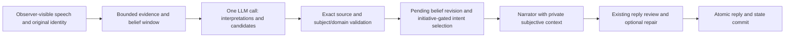

# CHPM qualitative appraisal stage

The live VN pilot now accepts bounded subjective interpretations in its existing
candidate-generation call. Nothing is enabled by default. Ordinary mode and the
shadow comparison remain available; NSFW prompts are unchanged.



The core retains supporting and challenging evidence, alternative explanations and
unknown causes. Reliability, competence, benevolence, affection and boundaries
are separate propositions about a particular person. An accepted interpretation
can be wrong; it remains an inference and cannot become a world event or edit the
original character. A malformed proposal or fabricated citation fails the whole
turn, preserving its previous state.

Inputs expose up to six recent speech excerpts (1,000 characters each) and eight
recent beliefs. Output allows two interpretations with two citations each. These
limits bound the protocol, not the accuracy of retrieval or psychological inference.
The existing settings still bound total input characters and output tokens. Calls
per live turn remain N + 2, or N + 4 with narration repair, plus the normal narrator.

The live selection policy is `initiative-gated-v1`; the older comparison path
retains `goal-first-v1`. The LLM still supplies intentions, goal alignment and
conditional dependencies. Matching quotations and structurally valid dependencies
do not prove semantic relevance. There are no numeric trust/affection changes, spontaneous trait edits,
automatic trauma recovery, or confidence inferred from source counts.

## Independent choice and necessary questions

An unsupported `CLARIFY` cannot outrank an available independent intention merely
because the generator labels the question as supporting a goal. A `question_gate`
must name a specific missing external fact or player's intention and two distinct
answers mapped to two other offered actions. Duplicate, unavailable or recursively
questioning branches do not unlock clarification. If equally useful independent
progress is available, it wins. If only lower-priority filler is available outside
the conditional actions, a necessary question can still win.

The policy does not select goal-conflicting compliance as a substitute for an
unsupported question. It keeps voluntary silence available and does not force
every character to be outgoing. Goal-grounding checks remain in place. The trace
records `selection_reasons` and the proposed `question_gate`, separately from
literary explanations generated after the choice.

Generic permission to continue talking/writing is excluded from the contract.
The narrator must express the chosen intention without handing that choice back
to the player, and the reviewer must reject added generic permission requests.
Specific player choices, including accepting an offered arrangement, remain theirs.
This is not a blanket ban on questions, dialogue invitations or negotiation.
An RP question can itself express initiative through curiosity, care, suspicion,
affection or bargaining. It does not require the information-gap gate unless it
defers the choice of intention. Generic approval-seeking cannot bypass that gate
by being labelled INITIATE. Question frequency alone is not a rejection criterion.

The gate's semantic classification and the prose review still depend on the model.
A dishonest/mistaken dependency can pass structural validation, so the live probe
and adversarial review checks measure residual errors rather than claim a perfect
semantic guarantee. These are explicit engineering policies, not proof of human
psychological fidelity.

## Reproducible live probe

Run only against an explicitly approved endpoint:

```bash
python -m backend.engine.chpm.evaluation.appraisal_probe \
  --endpoint https://YOUR-ENDPOINT/v1 \
  --output /tmp/chpm-appraisal-unique-run
```

This uses the existing router and inference admission controls with a temporary
configuration; it does not edit accounts or game sessions. The five fixed cases
cover a missed promise, an alternative cause, a repeated report, attempted identity
rewrite and a claimed completed action. Every input is an authored report, not a
confirmed world outcome. Four steps exercise cognition only; the final step also
uses the production narrator contract, reply review and in-memory `finish` boundary.
This is not an end-to-end live VN run or a substitute for a psychological evaluation.

The probe writes separate JSON records with decisions, before/after state, actual
model text, timing and provider token usage where available. It refuses to overwrite
an existing output directory. Failed cognition does not enter the accepted history.
Ordinary execution uses seven logical calls; a final repair can add two. Network
retries/fallback may involve additional transport attempts. The first four fixture
steps are deliberately not spoken NPC dialogue and cannot measure conversational
repetition or narrator fidelity.

Offline tests additionally cover unrelated relationships, exact citation boundaries,
unavailable subjects, invalid JSON, unauthorized state patches, 40 turns with all
seven categorical traits, atomic failure, old snapshots and copy/rewind provenance.
Passing these tests establishes software invariants, not psychological accuracy.
