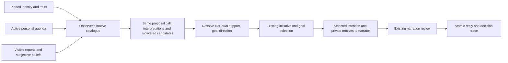

# Source-bound decision motives

The optional live VN pilot now records why **each proposed alternative** could
serve this NPC before selection. This implements a bounded part of the research
architecture's causal-intent contract (§6); it is not a calibrated utility model
or proof that the model has simulated human psychology.

## Flow

The catalogue comes from the pinned identity, reconciled active agenda and bounded
appraisal window. It cannot incorporate another NPC's private state. Reports and
beliefs reuse the appraisal window's aliases in the model input, avoiding duplicate
speech excerpts. The saved trace resolves these references to their text, subject,
source kind, status and provenance ID. Closed commitments are unavailable.

Every live candidate requires one to three `motives`: a host-provided `motive_id`,
`effect` (`supports` or `tension`), and a brief candidate-specific `relevance`.
These are concise proposed explanations, not an unrestricted reasoning transcript.
The host rejects unknown or duplicate IDs and requires at least one supporting
authored-character/trait/value/role/goal or active-agenda source. Player requests,
reports and subjective beliefs alone cannot meet that condition. A declaration
of a new goal on this same turn cannot manufacture its own prior justification.

For `goal_alignment=supports/conflicts`, the candidate must cite an authored goal
containing its exact `goal_quote`, with the corresponding support/tension effect.
A tradeoff is allowed: an action may conflict with one goal while drawing support
from another part of the character or an active commitment. Traits are tendencies,
not absolute prohibitions. Cooperation does not fail merely because the player
wants it, and refusal earns no automatic autonomy bonus.

## Narration and trace

The decision stores `motivation_policy=source-grounded-v1` and resolved
`candidate_motives` for all alternatives. The narrator and existing reviewer receive
only the selected alternative's motives, as private context. They must preserve
the distinction between an authored identity, declared intention, reported claim
and tentative/challenged belief. The reviewer also considers whether the proposed
relevance fits the selected intention and source. It must not demand that the NPC
recite these reasons, nor reject a contextual social question merely for being a
question. Generic permission to continue remains outside the NPC's decision needs.

No new endpoint, database table, model role, LLM call or default activation is added.
Old saved decisions load without motive fields; off/shadow retain their previous
paths. New live proposals must supply motives explicitly. Failed proposals or
rejected replies cannot commit their pending observations, appraisals or motives.
Existing edited-source invalidation, rewind and fork policies still apply; forks
discard cached decisions and rebuild their context.

## Cost and limits

The number of logical calls is unchanged, but the catalogue, output motives and
review context use additional tokens. Existing character, output and call budgets
remain enforced; oversized input or malformed output fails visibly. There is no
silent expansion of model context or truncation of the pinned character. A source
can appear in more than one motive category (for example the authored value also
appears as a trait); **source count is not a score** and gives no ranking bonus.

Structural validity establishes that a source exists, is accessible and was
referenced consistently. It does **not** prove that a relevance statement is
semantically correct. The model still proposes alternatives and goal alignment;
the existing goal/initiative selector still ranks them. This stage does not yet
rank competing motives by calibrated psychological weight. The prose reviewer
can also err. Neither its acceptance nor deterministic selection proves personality
fidelity. Numerical affect, desires, needs and personality development remain
separate future work.

Automated tests cover unavailable/foreign/closed sources, request-only motives,
contradictory goal directions, permitted goal tradeoffs, challenged beliefs,
source retraction, old/new serialization and real VN rollback after an invalid
unselected alternative. Different trait profiles produce different source inputs;
this data invariant is not a claim that their actions must always differ.
