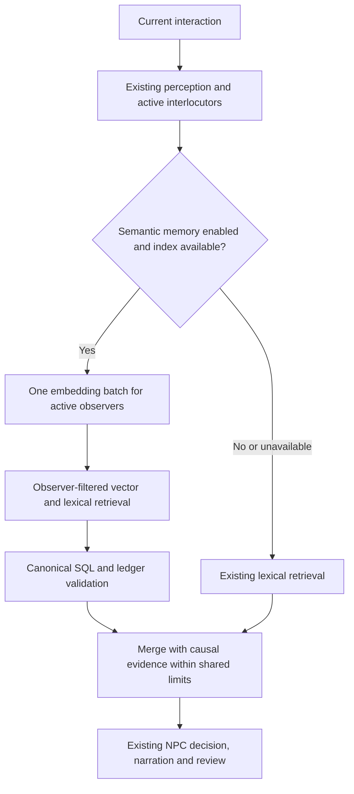

# Semantic NPC memory

NPC Personality 1.2.0 can use semantic similarity to find older observations when
the current interaction uses different words. This option is **disabled by
default**. It improves evidence retrieval; it does not turn a language model into
a complete psychological simulation or guarantee that it uses every fact.

## Enable

1. Configure and test an embedding model in **Admin → Memory & recall**, including
   any required query/document prefixes. A narrative chat endpoint is insufficient.
2. In session **NPC Personality**, select **Enabled**, choose the character roster,
   and enable **Semantic NPC memory (experimental)**. Adventure defaults can set
   this for new sessions; existing sessions keep their settings.
3. Allow idle indexing to catch up. Enabling schedules existing saved observations
   for indexing. New characters need actual recorded observations first.

The option works without agent rounds. Agent rounds remain separately optional
and retain their existing generative request cost. Switching semantic memory off
preserves personality and observed history, and returns to lexical recall.

## What a character can remember

The corpus consists of that observer's saved speech, narration and world-event
sources. It is not a search over unrestricted chat, private thoughts, another
NPC's knowledge or hidden inventory. Explicit reports retain their reported
status. No source is synthesized from a nearest vector match.

Each source is split into exact, overlapping 600-character excerpts with a
480-character stride. Speaker, observer and scene identifiers provide embedding
context. At retrieval, the original message, revision and content hash are checked
again. Edited, removed or incomplete messages cannot supply a valid match.
Reconciliation also invalidates dependent psychological history as before.

Identical words in different places remain separate source instances. The final
handoff preserves source/message references, scene ID and observation order, so
the model can distinguish episodes. Similarity means possible relevance, never
proof that two objects, events or people are identical. A character's remembered
description does not override current canonical inventory or clothing state.

## Turn path and cost

- One foreground embedding HTTP request contains one query per active observer;
  a 20-person roster with three active interlocutors embeds three queries, not 20.
  Each query is capped at 3,000 characters and uses perceived current excerpts
  and bounded ongoing circumstances.
- Embedding time uses the Memory & RAG request timeout, with a 0.5-second storage
  grace. New settings default to 30 seconds; explicit saved values are preserved.
  This is a separate allowance from shared narration recall, so two enabled paths
  can each wait up to the configured timeout plus grace before fallback. Increase
  the setting deliberately when a shared server or cold model needs more time.
- No additional generative LLM call is added. Up to two semantic sources per NPC
  share the existing eight-source / 6,000-character evidence budget with causal
  and agent evidence. Causal sources retain priority; request input limits remain
  unchanged. Token counts depend on language and tokenizer.
- Background indexing embeds up to 16 source excerpts in one batch per idle unit.
  It rotates fairly with public indexing and compression. A failed provider backs
  off without monopolizing unrelated maintenance. Initial indexing can take time.

The agent's `search_memory` argument refines lexical ranking. Its semantic scores
come from the current observer interaction, not another embedding request for
each tool argument. This distinction appears in the tool result/audit.

## Failure, privacy and saved sessions

Embedding failures or missing vectors keep lexical recall available and report
fallback in `usage.semantic_recall`. Queue uncertainty is never automatically
cleared or retried. A dedicated read session isolates retrieval cancellation from
the ongoing turn's database state. An already-running remote model request cannot
be preempted by this local timeout; separate embedding capacity is preferable.

Observer rows use a separate vector signature and mandatory namespace, owner,
session, epoch and observer filters. Public index maintenance cannot prune them.
Owner-scoped clear, rebuild and adventure deletion cover both namespaces.
SQL session saves remain canonical; vectors are rebuildable caches.

This additive feature keeps `KernelState.schema_version=6`, core snapshot version
4 and `transition_version=evidence-ledger-v3`. Old saves load with the feature off.
The original traits, values, goals and psychological reducer are unchanged.

## Validation and limits

Automated tests use real SQLite and LanceDB with deterministic test embeddings.
They cover paraphrase plumbing, source edits, epoch changes, wrong owners and
observers, repeated episode wording, 300 later observations, 20 saved observers,
three active queries in one batch, budgets and cancellation isolation.

These tests establish host behavior, not the quality of a particular embedding
model. A live multilingual retrieval benchmark and RP comparison remain necessary
before claiming better psychological fidelity or measured turn latency.
