# Complete player-turn lifecycle

This guide follows a player message through the checked-in engine: how the room is
assembled, how items and character states reach the models, how an NPC chooses a
response, what each check establishes, and what becomes visible on the next turn.
The main entry points are
[`post_chat_message`](../../backend/api/routes/adventures/gameplay.py),
[`GameTurnManager.process_turn` and `_process_turn_inner`](../../backend/engine/gameplay/manager.py),
and [`_run_llm_cycle`](../../backend/engine/gameplay/manager.py).

Read the [two full-turn diagrams](#the-turn-without-npc-personality) first for
orientation, then use the phase tables to inspect a particular check. The
[shorter pipeline diagrams](../diagrams/game_session_loop.mermaid) remain an overview.
This describes current implementation and its limits; a passing schema or source
check does not establish that a model understood a scene correctly.

## Contents

- [How a scene becomes a turn](#how-a-scene-becomes-a-turn)
- [Persistent owners and derived views](#persistent-owners-and-derived-views)
- [Turn without NPC Personality](#the-turn-without-npc-personality)
- [Turn with NPC Personality](#the-turn-with-npc-personality)
- [1. Request, ownership and recovery](#1-request-ownership-and-recovery-boundary)
- [2. Assemble the room and model context](#2-assemble-the-current-room-and-model-context)
- [3. Select the primary resolution request](#3-select-the-primary-resolution-request)
- [4. Ordered guardrails and event application](#4-ordered-guardrails-and-event-application)
- [5. NPC eligibility, perception and decisions](#5-npc-personality-eligibility-perception-and-decisions)
- [6. Emotion channels](#6-emotion-has-several-separate-channels)
- [7. Narration and shared NPC review](#7-assemble-generate-and-review-narration)
- [8. Completed VN physical effects](#8-extract-and-validate-completed-vn-physical-effects)
- [9. Commit, publication and background work](#9-commit-publication-and-background-work)
- [10. Interruption, rejection and recovery](#10-interruption-rejection-and-recovery)
- [11. Why prose and state can disagree](#11-why-prose-can-succeed-while-a-state-change-fails)
- [12. What the next turn sees](#12-what-the-next-turn-sees)
- [13. Requests, timing and diagnosis](#13-requests-timing-and-diagnosis)

## How a scene becomes a turn

The engine keeps persistent facts, builds a view of those facts for a particular
consumer, asks models for bounded proposals or prose, and applies accepted changes
through the existing domain owners. A scene is assembled repeatedly from saved
rows and projections. It is not recreated from the latest paragraph alone.

Four questions help follow any action:

1. **What exists now?** The session's world rows, avatar, possession records and
   current state ledgers answer this.
2. **What can this participant perceive or do?** Presence, discovery, containers,
   clothing coverage, source visibility, movement gates and observer-specific
   context answer different parts of this question.
3. **What does the model propose or describe?** Structured intents, NPC decisions,
   narration and extraction responses are candidates evaluated by their consumers.
4. **What was accepted and saved?** Domain application, source binding, revision
   checks and SQL commits determine the facts used on the following turn.

For example, knowing an NPC's name does not put them in the room. Carrying a jacket
does not mean wearing it. A visible tired expression does not reveal every private
feeling. An intention to pick up a lantern does not transfer that lantern.

### A worked example: a wet jacket and one lantern

Suppose Alex and Mira are in an archive while rain falls outside. Saved state
already says that Alex holds `LANTERN`, Mira wears `JACKET_BLUE`, its left sleeve is
torn, and Mira is tired. These are illustrative IDs and facts, not required schema
names. Alex writes: **“I offer Mira the lantern and ask her to check the doorway.”**

| Stage | What happens in this example |
| --- | --- |
| Read the scene | The engine reads the archive, its routes, Alex, Mira and the existing lantern/jacket identities. Rain, tiredness and the torn sleeve enter through their current saved context where available. |
| Build visible clothing | Mira's current worn references and coverage determine the visible jacket. A higher opaque layer can hide a tear from an observer without repairing it or deleting its state. |
| Resolve the player action | The progression/mechanics proposal is checked against the actual item, its owner and accessible targets. The offer does not authorize moving Alex through the doorway. |
| With Personality off | The ordinary narrator can give Mira dialogue and describe her reaction using authored character and scene context. No CHPM mind, private tool round or shared NPC reviewer is created. |
| With Personality live | Mira receives her own observations and eligible memory, then chooses a bounded intention. She may accept, defer or refuse the offer. A state read helps her identify the same `LANTERN`; it does not reserve it. |
| Narrate | The prose expresses the accepted host outcomes and, in live mode, the accepted NPC meaning. The model may describe Mira taking the lantern and removing the wet jacket. |
| Review and extract | Live NPC review checks expression against the selected meaning. The VN shared extractor separately proposes completed item/state effects with exact evidence. The existing lantern and jacket must retain their IDs. |
| Apply accepted facts | A valid lantern handover changes ownership. A valid jacket removal changes wear/placement. The tear remains until an accepted update changes that condition. A failed item chain leaves its previous ownership/wear intact. |
| Save and continue | The reply supplies source identity for accepted records. After commit, the next scene view reflects accepted ownership, wear and active conditions. Old prose or an old portrait does not restore the jacket to its former state. |

This example illustrates the boundaries; it does not promise that every literary
formulation produces the intended extraction. A model can write understandable
prose while returning a wrong ID, missing section, unsupported operation or
unusable citation. Those failures are explained [below](#11-why-prose-can-succeed-while-a-state-change-fails).

## Persistent owners and derived views

Most canonical records below are SQL rows or validated JSON stored in SQL. A
projection is a consumer-specific view built from those records; a vector index,
portrait color or scene pose has a different authority from an item's owner.

| Information | Persistent owner | How the turn uses it |
| --- | --- | --- |
| Session and avatar | `GameSession`, `SessionState`, `Avatar` | Ownership, current scene, clocks, actor sheet, inventory/equipment, session controls and status. See [models](../../backend/models/session_state.py) and [initialization](../../backend/engine/gameplay/manager.py). |
| Scene, exits, NPCs and objects | Session-scoped `WorldScene`, `WorldExit`, `WorldEntity`, plus session overrides | Current physical world and stable identities. [Context loading](../../backend/engine/gameplay/turn_llm_pipeline.py) reads the session copy; [target validation](../../backend/engine/mutation_targets.py) has explicit legacy-template fallback rules. |
| Story frame | Session narrative fields and adventure configuration; a saved manifest snapshot supplies fallback when the template is unavailable | Plot, rules, sequence guidance, language and style. See [initialization](../../backend/engine/gameplay/manager.py), [context builder](../../backend/engine/gameplay/turn_llm_pipeline.py) and [snapshot type](../../backend/engine/gameplay/snapshot.py). |
| Possession and clothing | Actor inventories/equipment, canonical item metadata, actor `visual_profile`, session item overrides | Item identity, current owner, worn layers, displacement and attachment are separate facts. See [possession snapshots](../../backend/engine/visual_novel/continuity.py), [profiles](../../backend/engine/clothing/profiles.py) and [projection](../../backend/engine/clothing/projection.py). |
| Physical and item conditions | [Physical-condition ledger](../../backend/engine/physical_conditions/ledger.py) in `entity_states` | Current injury/fatigue/body facts and mutable item dimensions, with status and source evidence. Current conditions supersede obsolete descriptions. |
| Room continuity | [Scene-continuity ledger](../../backend/engine/scene_continuity/ledger.py) | Room facts, actor/scene consequences, causal references and final-frame actions, filtered for scene/audience/source. |
| Optional pose and prop placement | [Scene staging](../../backend/engine/scene_staging/state.py) and its source-bound prop projection | Derived spatial presentation. Invalid or obsolete staging does not grant possession or movement. |
| Conversation and recall | `ChatMessage`, canonical memory/World Info records; [retrieval](../../backend/engine/memory_rag/retrieval.py) derives bounded selections | Earlier dialogue, facts or claims with provenance/audience. Embeddings are a derived lookup cache; fresh SQL remains authoritative. |
| NPC private psychology | [`KernelState` / CHPM state](../../backend/engine/chpm/state.py) | Observer-local reports, beliefs, experience, agenda and decision history. Live reviewed state has different publication rules from shadow observations. |
| NPC private notebook | [Notebook SQL storage](../../backend/engine/chpm/notebook_store.py) | One current owner/session/NPC-scoped JSON document, staged through the tool loop and persisted only when eligible. It is not executed as code. |
| Portrait emotion/thought | [`ChatMessage.portrait_state`](../../backend/models/chat.py) | Hash-bound UI presentation for a particular reply, generated by the narrator and validated independently of CHPM. |
| Illustration moment | [Frozen scene snapshot](../../backend/engine/scene_illustrations/snapshots.py) | Captured source-bound visual facts; later rendering must not replace them with a newer outfit. Image generation does not commit game actions. |

## Reading the diagrams

- **Host** means Python/SQL code, schema checks or domain reducers.
- **LLM** means a model request; its semantic judgment can be wrong even if JSON is valid.
- **Mixed** means model interpretation followed by deterministic checks.
- **Queued** means scheduled work that can finish after the foreground turn.

A box labelled “check” is expanded in the corresponding tables. Arrows represent
control/data dependencies, not fixed durations or one SQL transaction. The engine
can commit short recovery-protected transactions before model calls while retaining
the session's mutation lease.

## The turn without NPC Personality

This covers the common non-command turn with Personality **off**. It also shows
where other modes and early branches leave that path. CHPM is skipped outside VN
regardless of its saved mode. Independent Living World, portrait presentation,
clothing, physical-state and recall settings still have their own gates.

```mermaid
flowchart TD
    A["Player submits chat request"] --> B["Host: authenticate and wrap SSE with turn ID and heartbeats"]
    B --> C["Host: acquire session lease and foreground inference priority"]
    C --> D["Host: check Living World catch-up and recover an interrupted turn"]
    D --> E["Host: load owned session, avatar, adventure or snapshot fallback"]
    E --> F{"Early command, combat, terminal or replay branch?"}
    F -->|Yes| Early["Use dedicated handler under its recovery and final-hook path"]
    F -->|Normal message| G["Host or mixed: normalize input and block known unreachable inspect/search"]
    G --> H["Host: save or reuse player input and record recovery snapshot"]
    H --> I["Host: assemble session scene, possessions, current conditions and bounded recall"]
    I --> J{"Primary resolution path"}
    J -->|Mechanics enabled| K["LLM: MechanicsIntent then host skill and attack rolls"]
    J -->|VN| L["LLM: VNProgressionIntent"]
    J -->|Other mechanics-disabled play| M["LLM: ChatProgressionIntent"]
    J -->|Generator chat| N["LLM or existing confirmation: generator tool intent"]
    K --> O["Host or mixed: target IDs, crafting, item integrity, locks, switches, movement and reveal gates"]
    L --> P["Host or mixed: confirm player travel, prepare canonical possessions, wardrobe and VN direction"]
    M --> P
    P --> O
    N --> Q["Host: process generator proposal and permitted catalog tools"]
    O --> R["Host: apply accepted event and applicable progression checks"]
    R --> S["Host: logic scripts, scene or sequence clock boundary, refreshed context"]
    Q --> S
    S --> T["Host: emit intermediate state and prepare narration context"]
    T --> U["Host: Personality off adds no CHPM decision or tool request"]
    U --> V["LLM: narrator streams prose with optional portrait footer"]
    V -.-> Visible["Client receives unbuffered prose before final state checks"]
    V --> W["Host: strip and validate presentation footer, inspect completion reason"]
    W --> X{"Completed VN narration?"}
    X -->|Yes| Y["LLM: one shared item, condition, scene and movement extraction"]
    Y --> Z["Host: exact evidence, identity, ownership, item chains and independent-domain checks"]
    Z --> Repair["Conditional LLM coverage correction within original deadline"]
    Repair --> AA["Host: retain validated effects and record rejected or unconfirmed parts"]
    X -->|Other mode or incomplete| AB["Keep mode-specific outcomes and completion diagnostics"]
    AA --> AC["Host: optional staging consumption, post-narration reveal and reply creation"]
    AB --> AC
    AC --> AD["Host: bind movement and physical or room facts to persisted reply, run narrative hooks"]
    AD --> AE["Host: capture eligible visual context, mark response and memory index dirty, commit"]
    AE --> AF["Queued: journals, memory refresh and eligible scene images"]
    AE --> AG["Host: checkpoints, final payload, post-turn unlock and aggression hooks"]
    AG --> AH["Host: finish recovery receipt, emit final and saved input identity"]
    AH --> AI["Next turn reads accepted canonical state"]
    I -.-> Fail["Failure: explicit error and applicable durable recovery"]
    K -.-> Fail
    L -.-> Fail
    M -.-> Fail
    V -.-> Fail
    Fail --> Recover["Restore recoverable state, retain eligible interrupted draft, reconcile history"]
```

The correction box is conditional: it is not a second request for every extraction.
Domain rejection can preserve valid unrelated facts and continue to the commit;
it is distinct from an unrecoverable pipeline failure.

## The turn with NPC Personality

The full live path inserts observer-specific cognition **after** primary world
resolution and context refresh, and **before** narration. It then adds shared
meaning review and reviewed psychology publication. The same physical world
owners still validate effects afterward.

```mermaid
flowchart TD
    A["Player submits chat request"] --> B["Host: authentication, SSE wrapper, session lease and foreground priority"]
    B --> C["Host: Living World gate, interrupted-turn recovery, owned session initialization"]
    C --> D["Host: early branches or normal input visibility check and durable input receipt"]
    D --> E["Host: session scene, canonical items, clothing, conditions and bounded recall"]
    E --> F["LLM plus host: mode-specific intent, travel confirmation, ordered domain guardrails and event application"]
    F --> G["Host: scripts and game-clock boundary, refresh resolved context, emit intermediate state"]
    G --> H{"CHPM eligibility and mode"}
    H -->|Off or non-VN| Ordinary["Use ordinary narration path without CHPM processing"]
    H -->|Shadow| Shadow["LLM plus host: observe and evaluate, record shadow status, add no live narrator contract"]
    H -->|Live| I["Host: compatibility, saved input, source integrity, roster and capacity admission"]
    I --> J["LLM: shared passage-based perception of current player message"]
    J --> K["Host: validate fragment accounting and observer scope, reconcile prior sources"]
    K --> L["Host: prepare each NPC identity, current host frame, own memory and optional notebook workspace"]
    L --> M["Optional embedding: observer-local semantic recall with lexical fallback"]
    M --> N{"Staged or Integrated workflow"}
    N -->|Staged| O["Optional bounded tool rounds, then LLM decision proposal"]
    N -->|Integrated| P["LLM alternates valid tool batches with final submit_decision"]
    O --> Q["Host: validate motives, citations, beliefs, experience, agenda and selected intention"]
    P --> Q
    Q --> R["Conditional LLM: one shared proposal repair for completed invalid proposals"]
    R --> S["Host: settle NPC results, defer only eligible failed actor or select failure policy"]
    S --> T["Host: preflight reviewer budget and build accepted narrator meaning contract"]
    T --> U["LLM: narrator produces candidate prose and optional portrait footer"]
    U --> V["Host: retain live prose on server, strip private presentation footer"]
    V --> W["LLM plus host: shared meaning review, exact expression coverage and source checks"]
    W --> X{"Review result and failure policy"}
    X -->|Accepted| Y["Host: retain reviewed expressions and turn-local psychology"]
    X -->|Explicit mismatch and unused repair budget| Z["LLM: at most one prose repair, then another review"]
    Z --> X
    X -->|Eligible Keep playing fallback| Simple["LLM only if needed: fresh ordinary reply, freeze proposed psychology"]
    X -->|Strict or unsafe failure| Fail["Explicit error and durable turn recovery"]
    Y --> AA["LLM: completed VN shared item, condition, scene and movement extraction"]
    Simple --> AA
    AA --> AB["Host: validate source spans, item chains, current owners and independent effects"]
    AB --> AC["Conditional coverage correction, apply accepted effects, keep rejected facts unchanged"]
    AC --> AD["Host: staging, post-narration reveal, create assistant identity and bind final movement or ledgers"]
    AD --> AE["Host: scripts, visual snapshot, source dependency check, notebook CAS and reviewed CHPM finish"]
    AE --> AF["Host: mark committed response and memory dirty, commit canonical turn"]
    AF --> AG["Queued maintenance plus host checkpoint and final payload preparation"]
    AG --> AH["Host: post-turn hooks and recovery finalization"]
    AH --> AI["Client: release held live prose immediately before final receipt"]
    AI --> AJ["Next turn: updated physical host frame plus eligible reviewed private memory"]
    I -.-> Fail
    J -.-> Fail
    Q -.-> Fail
    Fail --> Recovery["Restore applicable durable backup, preserve eligible draft, report recovered history"]
    Ordinary --> OrdinaryEnd["Ordinary stream and shared domain finalization from the first diagram"]
    Shadow --> OrdinaryEnd
```

The diagram abbreviates conditional policies: a rejected repair returns to the
configured review/fallback policy, not directly to acceptance. A simplified reply
uses shared state extraction only when it is a completed VN narration. The
[failure table](#10-interruption-rejection-and-recovery) gives the exact distinctions.

## 1. Request, ownership and recovery boundary

| Check or operation | Inputs and algorithm | Failure or output | Owner / kind |
| --- | --- | --- | --- |
| Authenticate the request | FastAPI dependencies provide the current user; the manager resolves the session through that user's scope. The route creates a turn ID and forwards `content`, language, correction and optional replay ID. | Missing/foreign session produces a session-not-found/error path, not another user's state. SSE events carry the turn ID. | [Route](../../backend/api/routes/adventures/gameplay.py), [session access](../../backend/engine/gameplay/session_access.py) — Host |
| Acquire a writer lease | `session_write_lease` checks an in-process map without awaiting. An inherited explicit lease must match the active session capability. | An occupied/invalid lease returns a retryable busy error. This is a single-worker process guard, not a distributed database lock. | [Concurrency](../../backend/engine/visual_novel/concurrency.py) — Host |
| Prioritize the foreground | `foreground_turn` registers player activity with the maintenance scheduler; already submitted background inference is not preempted. | New cooperative maintenance waits for inactivity. Cleanup releases activity even on disconnect. | [Scheduling](../../backend/engine/memory_rag/scheduling.py) — Host |
| Check Living World catch-up | For a normal new turn, reconcile saved simulation target/cursor and due events. An enabled, non-live catch-up simulation with unfinished work blocks new play until catch-up is continued. | A specific busy response is returned. This does not start another private NPC decision phase inside this foreground turn. | [Foreground gate](../../backend/engine/living_world/foreground.py) — Host |
| Recover an interrupted execution | Read the durable `TurnReplay` status and owner. Restore a pending execution/replay backup before starting another turn. Explicit replay additionally validates the exact latest completed assistant identity. | Unavailable replay is refused; recoverable incomplete work restores its applicable snapshot. | [Replay service](../../backend/engine/turn_replay/service.py), [stream wrapper](../../backend/engine/turn_replay/stream.py) — Host |
| Initialize the manager | Load session, avatar and template; use `AdventureSnapshot` fallback if the template is gone. Resolve content language, JSON-safe inventory/equipment and current scene/sequence anchor. | Missing required context stops the turn. Initial map registration failure is logged separately. | [`initialize`, `_process_turn_inner`](../../backend/engine/gameplay/manager.py) — Host |

### Early input branches

These branches precede the normal model cycle; they must not be counted as a fixed
mechanics → NPC → narration sequence.

| Branch | Actual behavior and owner |
| --- | --- |
| Empty input | Uses `[LOOK AROUND]` internally. A normal nonempty input is needed for a saved player-message identity; CHPM does not manufacture one. [Manager](../../backend/engine/gameplay/manager.py). |
| Suggestion shuffle | `/shuffle`, `/suggest`, `/suggestions` regenerate suggestions, commit and return a final snapshot. [Manager](../../backend/engine/gameplay/manager.py), [suggestions](../../backend/engine/gameplay/turn_suggestions.py). |
| Play-Agent commands | Existing agent command handler runs, then returns the appropriate final state. This is a separate player-agent contract. [Agent commands](../../backend/engine/gameplay/agent_commands.py). |
| Terminal input lock | A completed ending allows review but refuses new story actions; the terminal-epilogue endpoint is separate. [Terminal progression](../../backend/engine/gameplay/terminal_progress.py), [manager](../../backend/engine/gameplay/manager.py). |
| Exit traversal | `/traverse_exit` uses the dedicated traversal handler and its resulting narration path. [Traversal](../../backend/engine/gameplay/turn_traversal.py). |
| Debug commands | Require global or session debug authorization, except specifically allowed mode toggles/shortcuts; unauthorized debug becomes an unknown command. [Debug handler](../../backend/engine/gameplay/turn_debug.py), [manager](../../backend/engine/gameplay/manager.py). |
| Active combat / fight | An active non-VN combat phase and explicit fight/attack requests use combat handlers, their rolls, turn order and final payload. They are distinct from the ordinary prose cycle. [Combat manager](../../backend/engine/gameplay/combat/manager.py), [player actions](../../backend/engine/gameplay/combat/player_actions.py), [manager](../../backend/engine/gameplay/manager.py). |
| Parsed slash actions | Say, inspect, open, read, push/pull, search, look, rest, take and combine can become a normalized ordinary request. Equip/consume/direct inventory and other slash results use dedicated handlers. Pickup reactions can reenter `_run_llm_cycle` with `narration_only`. [Command parser](../../backend/engine/command_parser.py), [slash handling](../../backend/engine/gameplay/turn_slash.py). |
| Known unreachable inspect/search | The host first looks for known out-of-reach identity tokens. Only then can a small-model classifier establish inspect/search intent. A target matching only unavailable identities is blocked; generic unknown room words pass. Classification failure skips this preliminary check. [Inspect guard](../../backend/engine/gameplay/guardrails/inspect.py) — Mixed. |

The `narration_only` flag skips the primary mechanics/progression/tool-intent pass
and the normal VN interaction-planning block. Its name is not a global prohibition
on every later script, review, reconciliation or persistence operation in the
cycle. Inspect the caller and downstream gates when changing reaction behavior.

For an ordinary nonempty message, `record_input` saves a player message or reuses
the same durable failed input. Eligible turns capture a pre-turn recovery record.
Legacy shared avatars, generator sessions and some command paths have different
replay eligibility. [`release_for_model`](../../backend/engine/turn_replay/transactions.py)
commits short transactions before remote inference; on its first protected use it
captures the execution backup, including the saved player input. The session lease
continues to be held.

## 2. Assemble the current room and model context

Owner:
[`TurnLlmContextBuilder`](../../backend/engine/gameplay/turn_llm_pipeline.py),
[`MemoryManager`](../../backend/engine/memory_manager.py),
[context helpers](../../backend/engine/gameplay/turn_context_helpers.py).

| Assembly step | Inputs and checks | Result |
| --- | --- | --- |
| Read the physical world | Query the current session scene, session entities, adjacent exits and session scene map. Apply `entity_states` overrides and orient supported bidirectional routes. | Current host world snapshot with stable IDs. |
| Partition entities | Require physical presence and current scene, exclude inventory and contained items from loose room objects, then split visible/hidden by discovery. | Visible scene participants plus a separate hidden GM block. Hidden GM hints are not public NPC knowledge. |
| Remember identities | Mark visible NPCs as remembered; mechanics can receive remembered off-scene NPC metadata. Narration does not receive that off-scene block as present cast. | Recognition persists without teleporting or reintroducing an absent speaker. |
| Build stable story prefix | Combine adventure premise with effective plot/rules/sequence guidance, then selected narrator style and content language. | Relatively stable system prefix; live state is supplied separately. |
| Build mechanical view | Concise room, avatar sheet, exits, mechanical objects, lock requirements, accessible state and relevant remembered identities. | Technical proposal context; it has a different purpose from an observer's private view. |
| Build narrator view | Full room and active participants, current clock, mode/sequence guidance and current state. For VN, replace raw NPC inventory descriptions with current appearance/clothing projections. | The narrator receives resolved current facts, not a demand to repeat every field in prose. |
| Add recall | Prepare one bounded turn recall; reuse vector-query results across same-turn context rebuilds, reread/rerank canonical SQL after awaits. Verify cached source hashes and user/session/template/epoch/signature. | Hybrid/vector-assisted or SQL lexical selection. Vector failure falls back; missing recall does not erase canonical state. |
| Add audience-specific memory | Build narrator/mechanics recall blocks using their own source/audience rules. With recall disabled, existing notes, compressed history and world memories use the fallback path. | Earlier claims retain provenance. A recalled rumor does not become established present ownership. |
| Add continuity and optional planning | VN adds applicable room continuity/staging context. Living World conversation/private-context helpers remain separately gated. | NPC Personality off does not disable all other scene or initiative mechanisms. |

Recall owners:
[retrieval](../../backend/engine/memory_rag/retrieval.py),
[prompt audience selection](../../backend/engine/memory_rag/prompts.py),
[document collection](../../backend/engine/memory_rag/recall_sources.py).

### Presence, items, clothing and physical conditions

These checks answer different questions and are deliberately separate.

| Question | Algorithm and failure meaning | Source |
| --- | --- | --- |
| Is Mira in the scene? | Resolve current room and presence (`present`, `audible`, `absent`) independently from discovery. Audible speech from outside does not authorize touching or exchanging items; absent NPCs cannot participate as present actors. | [NPC presence](../../backend/engine/npc_presence.py) |
| Who owns the lantern? | Build a canonical possession snapshot: player inventory/equipment first, present accessible NPC inventories, open accessible containers and visible portable room items. Retain a wider identity catalog so an unavailable existing item cannot become a fabricated new copy. | [Possession snapshot](../../backend/engine/visual_novel/continuity.py) |
| Is the jacket worn? | Resolve worn item IDs against canonical owned inventory/equipment and validate the appearance profile. Carrying, wearing, being placed in the room and being attached are distinct. | [Clothing context](../../backend/engine/clothing/context.py), [profiles](../../backend/engine/clothing/profiles.py) |
| Which layers are visible? | Project worn coverage by body region; higher opaque layers occlude lower ones. Account for established displacement and uncovered regions. Missing/malformed coverage produces limited/unknown visibility, not proof of removal. | [Clothing projection](../../backend/engine/clothing/projection.py), [narration adapter](../../backend/engine/clothing/narration.py) |
| Is the sleeve still torn? | Read active physical/item-state records. Resolved records supersede old descriptions; absence from recent prose does not clean, heal or repair. Corrupt saved state becomes unavailable/review-required and is preserved. | [Physical presentation](../../backend/engine/physical_conditions/presentation.py), [ledger](../../backend/engine/physical_conditions/ledger.py) |
| Is rain still relevant? | Project applicable current-room continuity and its source/audience validity. An expired review remains projected as needing confirmation. Environment facts whose description source changed are omitted from ordinary narration/public views and retained for private review; neither case automatically ends the saved record. Ending a cause does not erase its remaining consequence. | [Scene continuity presentation](../../backend/engine/scene_continuity/presentation.py), [ledger](../../backend/engine/scene_continuity/ledger.py) |
| Does a pose imply a physical change? | Optional staging records source-bound pose/relative placement. Changed cast, source or canonical position can invalidate that projection. | [Staging state](../../backend/engine/scene_staging/state.py), [shared staging](../../backend/engine/scene_staging/shared.py) |

## 3. Select the primary resolution request

The current predicates are in
[`_run_llm_cycle`](../../backend/engine/gameplay/manager.py), using
[`mode_policy`](../../backend/core/game_modes.py). The saved `strict_rules` override
can change mechanics selection for non-VN play. VN always suppresses RPG mechanics.

| Predicate | Request / preparation | Subsequent host work |
| --- | --- | --- |
| `policy.mechanics and not narration_only` | Small role, `MechanicsIntent` with the enabled dynamic-location schema. Story uses its streamlined mechanics suffix. | Resolve optional local-place proposal, convert to `GameEvent`, perform host rolls, ordered guardrail chain and event application. |
| Mechanics disabled, ordinary adventure, not `narration_only` | Small role, `ChatProgressionIntent`; VN substitutes `VNProgressionIntent` and its progression context. This includes ordinary Chat and non-VN modes with mechanics overridden off. | Confirm player movement, resolve optional local place, hydrate possession proposals, then apply the common domain chain. VN adds time-passage, wardrobe and direction preparation. |
| Adventure generator, non-strict, not `narration_only` | Existing image-confirmation branch or small-role `AdventureGeneratorToolIntent`. Recent generator discussion is bounded. | Handle confirm/cancel/retry, catalog requests and a generation proposal; actual world generation has its own staged job lifecycle. |
| `narration_only` | Skip the primary structured request. | Continue the applicable later cycle; the flag is not a new state sandbox. |

Schemas and layout:
[`llm_intents.py`](../../backend/engine/llm_intents.py),
[VN intent](../../backend/engine/visual_novel/intent.py),
[progression request timing](../../backend/engine/gameplay/progression_request.py),
[prompt layout](../../backend/engine/gameplay/turn_prompt_layout.py).
Native schema output, JSON compatibility and prompt-only output all retain local
validation; see [structured output](../structured-output.md).

### Host rolls and travel authorization

Mechanics requests propose skill checks/attacks; host code rolls dice, computes
modifiers and target armor, writes transparent results and attaches resulting
accepted effects. A model-supplied success does not replace those rolls. Missing
combat health for an attacked target is an error. Combat auto-triggering still
uses the mode and combat owners. See [skill checks](../../backend/engine/skill_check.py),
[combat triggers](../../backend/engine/gameplay/combat/triggers.py) and
[the mechanics branch](../../backend/engine/gameplay/manager.py).

The progression branch's
[`confirm_player_movement`](../../backend/engine/gameplay/movement_intent.py)
resolves known map IDs and open candidate destinations. A small semantic check
must confirm immediate player traversal to the same destination with an exact
quote from the current player message. Plans, questions, ambiguous destinations
and an NPC leaving alone do not authorize player travel. Malformed/unconfirmed
answers keep the player in place. A proposed shared departure can also retract
its accompanying NPC movements; an intentional NPC-only departure remains
separate. See [transition confirmation](../../backend/engine/gameplay/scene_transition_intent.py).

Dynamic place proposals use their existing feature/identity gates and cleanup;
unentered proposals are discarded. See
[dynamic-location service](../../backend/engine/dynamic_locations/service.py).
VN wardrobe preparation requires performed-action evidence, available source and
actor agency; an existing garment is reused by ID. Unsupported wardrobe proposals
become explicit errors rather than permission to fabricate clothing. See
[wardrobe planning](../../backend/engine/clothing/planning.py).

## 4. Ordered guardrails and event application

[`run_guardrail_chain`](../../backend/engine/gameplay/turn_pass_flow.py) runs the
following order. Although commonly called Pass 1.5, some guards invoke a small
semantic classifier; the entire chain is not a purely deterministic text parser.

| Order | Check | How it checks and what rejection does | Owner / kind |
| --- | --- | --- | --- |
| 0 | Canonical mutation targets | Resolve exact IDs, unique case-folded IDs or unambiguous exact names in the session/current inventory. No fuzzy semantic alias guessing. Remove unsupported targets; discard this turn's proposed unstructured memories/notes when their association becomes unsafe, while retaining existing history and valid independent mutations. | [Target index](../../backend/engine/mutation_targets.py) — Host |
| 1 | Crafting | Check recipe/ingredient availability, requested combination and configured safe guard expression; construct only the authored result and apply supported hooks/consumption. | [Crafting guard](../../backend/engine/gameplay/guardrails/crafting.py) — Host / bounded intent handling |
| 2 | Item integrity | Ordinary acquisition/spawn proposals must match known canonical items when dynamic generation is disabled. Canonicalize known metadata; block duplicate acquisition of an already owned instance. Trusted/scripted grants have their own authority. | [Item guards](../../backend/engine/gameplay/guardrails/items.py) — Host |
| 3 | Container access | Resolve the candidate, then evaluate soft-rule/switch-flag state, code, actual key possession/use and safe expression. A container needs an explicit unlock proposal. Re-lock denied access and revoke dependent turn rewards; configured failure hooks can run. | [Containers](../../backend/engine/gameplay/guardrails/containers.py), [lock engine](../../backend/engine/gameplay/guardrails/locks.py) — Mixed |
| 4 | Exit unlock/traversal | Match the directional route and lock requirements. Traversal can satisfy an otherwise permitted exit; a soft-rule unlock still requires the appropriate proposal. Revert denied travel/unlock and dependent rewards. | [Exit guards](../../backend/engine/gameplay/guardrails/exits.py), [lock engine](../../backend/engine/gameplay/guardrails/locks.py) — Mixed |
| 5 | Switch transition | Read current/target state, configured transition, gates and safe expression; execute corresponding success/failure hooks and allowed outcomes. A denied transition restores the old switch state and revokes dependent rewards. | [World-rule guards](../../backend/engine/gameplay/guardrails/world_rules.py), [switch service](../../backend/engine/switch_service.py) — Host / expression |
| 6 | NPC movement | Canonicalize destination against session scenes; check moveability and allowed scenes. Reject unknown/restricted destinations; a spatial change within the same room has separate behavior. | [Movement guards](../../backend/engine/gameplay/guardrails/world_rules.py) — Host |
| 7 | Hidden-entity reveal | Check the hidden scene entity and supported discovery evidence/reveal rule. A semantic discovery check may be needed. Accepted discovery changes visibility; mentioning an identity does not by itself grant access everywhere. | [Reveal guard](../../backend/engine/gameplay/guardrails/reveals.py) — Mixed |
| 8 | Non-VN progression/endings | Check quest/award requirements and inaccessible dependencies. Hard ending guards can trigger valid terminal outcomes and block an unsupported model-proposed win/loss. | [Progress guards](../../backend/engine/gameplay/guardrails/progress.py), [hard-rule evaluator](../../backend/engine/hard_rule_evaluator.py) — Host / expression |

Rejection messages are saved/emitted and included in narration resolution. The
manager tells the narrator to describe denied changes as unsuccessful. Exact
checks prevent specific invalid mutations; semantic fidelity of the eventual
wording remains a separate question.

### Apply through the current domain owners

[`TurnStateApplier._apply_game_event`](../../backend/engine/gameplay/turn_state_applier.py)
rechecks mutation targets and enforces the VN last-line policy. VN removes RPG
resource/combat/quest/award/ending mutations even if an imported or unexpected
proposal includes them. Its supported movement and possession facts remain.

The event applier then prepares canonical inventory, applies avatar outcomes,
scene transition, entity movement/updates, item/inventory hooks and supported
spawns; applies notes and progression; evaluates configured deterministic
awards/quests/sequences; updates exits; synchronizes VN ownership/wardrobe and NPC
inventories; applies world memories and elapsed time; flushes the result.
These steps are implementation order, not separate permissions for the model.

Owners:
[VN policy](../../backend/engine/visual_novel/event_policy.py),
[inventory](../../backend/engine/gameplay/turn_event_inventory.py),
[scene transitions](../../backend/engine/gameplay/turn_event_scenes.py),
[progression](../../backend/engine/gameplay/turn_event_progression.py),
[world/time](../../backend/engine/gameplay/turn_event_world.py),
[VN ownership](../../backend/engine/visual_novel/ownership.py),
[wardrobe runtime](../../backend/engine/clothing/runtime.py).

### Scripts, game time and refreshed context

The mechanics branch has standalone scene-entry/entity-interaction dispatch where
configured. Both primary paths can run `on_logic_pass_done`. A changed scene or
sequence closes the old in-game turn, advances applicable elapsed time, applies
non-VN status ticks, then opens the new turn:
`on_turn_end` → clock/ticks → `on_turn_start`.
VN additionally supports bounded within-scene elapsed time/time-passage rules.
Plain messages do not each add one fixed `time_per_turn` increment.

After resolved movement, entity changes, a clock boundary or applicable VN
wardrobe/time change, the manager can rebuild context. The narrator then receives
the destination and current facts. The intermediate SSE `state` snapshot supports
immediate UI updates; later recovery can still require reloading canonical state.

Sources:
[turn flow](../../backend/engine/gameplay/turn_pass_flow.py),
[VN time passage](../../backend/engine/visual_novel/time_passage.py),
[scripting guide](../scripting_engine.md),
[manager](../../backend/engine/gameplay/manager.py).

## 5. NPC Personality: eligibility, perception and decisions

The integration owner is
[`chpm.runtime.prepare`](../../backend/engine/chpm/runtime.py).
It returns without CHPM inference for mode `off`, non-VN play or a missing saved
player-message ID. Shadow evaluates a separate observation path without adding a
live narrator contract or publishing a live mind. Live mode can steer the selected
NPCs, subject to the checks below.

The manager currently emits **“Preparing NPC responses...” even when CHPM is
off**. A status message is not proof that an additional model request happened.

### Admission and observer-specific preparation

| Phase | Inputs, checks and algorithm | Failure / meaning | Owner / kind |
| --- | --- | --- | --- |
| Compatibility | Validate session/template settings. Live CHPM conflicts with enabled Living World private deliberation; rules-only Living World can coexist. This check is session-wide. | Incompatible configuration stops live preparation rather than allowing two private controllers. | [Template settings](../../backend/engine/chpm/template_settings.py) — Host |
| Saved state and capacity | Fully validate saved `KernelState`; require the existing recoverable turn; check retained events, sources, beliefs, experience and logical model-call reserve before inference. | Capacity/integrity problems do not silently evict canonical history or increase budgets. Recoverable failures follow the configured policy. | [Runtime](../../backend/engine/chpm/runtime.py), [capacity](../../backend/engine/chpm/capacity.py) — Host |
| Active roster | Determine eligible configured present actors. Prefer engagement, then recent interlocutors, then oldest activity with stable ID tie-breaking. Too many engaged actors are an explicit capacity failure. | A configured NPC without an active decision must not gain new controlled dialogue/decisions through the narrator. Independent portrait display remains possible. | [Roster](../../backend/engine/chpm/roster.py) — Host |
| Shared perception | Split the current message into indexed quoted/sentence fragments. One model assigns fragment type, observers and engagement. Current bounds are 6,000 input characters and 32 fragments. | The host requires exact fragment accounting, no duplicate/foreign IDs and valid observer/engagement sets. Private/unobserved material cannot become public observation by declaration. This checks accounting, not perfect interpretation. | [Perception](../../backend/engine/chpm/perception.py), [fragment index](../../backend/engine/chpm/perception_fragments.py) — Mixed |
| Scene mismatch | Compare saved input scene with the current resolved scene. When they differ, do not project the old-scene message as if heard in the new room. | Actors receive uncertain/no excerpts for that projection. | [Runtime preparation](../../backend/engine/chpm/runtime.py) — Host |
| Reconcile prior evidence | Recheck local canonical messages against session, role, revision, hash, exact quotation/span, source lineage and observed-scene anchors. Debug/incomplete sources are excluded where required. | Invalidated evidence retracts the dependent causal suffix and related private context; it is not silently reconstructed from new prose. | [Host sources](../../backend/engine/chpm/host_sources.py), [host adapter](../../backend/engine/chpm/host_adapter.py) — Host |
| Build each host frame | Pin authored identity and prepare current room, visible actors, own possessions/worn IDs, own conditions, permitted room facts and eligible spatial facts. Compare old/new typed snapshots. | Unknown inventory/coverage/conditions stays unknown. A gained/lost item observation does not invent its cause. | [Host adapter](../../backend/engine/chpm/host_adapter.py), [host observations](../../backend/engine/chpm/host_observations.py) — Host |
| Own memory and notebook | Prepare the NPC's reconciled quotation window, agenda and optional owner-scoped notebook workspace before parallel model jobs. | Another NPC's mind or private notebook is not supplied as common context. | [Actor preparation](../../backend/engine/chpm/actor_preparation.py), [notebook store](../../backend/engine/chpm/notebook_store.py) — Host |
| Optional semantic recall | Batch eligible observer queries; validate owner/session/observer/epoch/signature and source hashes after await. | Embedding failure falls back to lexical recall. Narrator-wide RAG is not substituted for an NPC's observed memories. | [Semantic recall](../../backend/engine/chpm/semantic_recall.py) — Optional embedding + Host |

Private model jobs can run with bounded concurrency after their database views are
prepared. Results are settled/applied in stable actor order. This is not a
parallel item-reservation system. See
[parallel preparation](../../backend/engine/chpm/parallel.py).

### Tools and the two decision workflows

[Staged and Integrated workflows](../npc-decision-workflows.md) share the same
observer scope, autonomy limits and final proposal checks.

| Workflow | Model interaction | Host boundary |
| --- | --- | --- |
| Staged | Optional bounded tool rounds, followed by a full decision proposal. Without the notebook, the existing staged JSON planner is retained. | Each tool envelope is validated before operations. The final decision remains a separate accepted proposal. |
| Integrated | Each bounded response can request tools or submit the final decision through `submit_decision`; the final allowed response must submit a decision. | Mixing a decision submission with memory operations, duplicate IDs or an invalid envelope executes no operations. |
| Native / JSON compatibility | Select the supported transport before dispatch. `auto` can select JSON; explicitly unsupported native mode fails recoverably. | There is no blind protocol resend after an uncertain dispatched request. Tool feedback can support correction within the remaining rounds. |

Owners:
[native/compatibility selection](../../backend/engine/chpm/agent_native.py),
[integrated loop](../../backend/engine/chpm/integrated_request.py),
[tool contracts](../npc-observable-state.md),
[private notebook guide](../npc-notebook.md).
Current configured agent rounds are bounded to three; model responses/tool batches
and character budgets are additionally bounded by their existing schemas.

The available read tools supply citable data, not action side effects:

- `inspect_entity` reads an exact accessible ID from a captured current view. It
  checks session, observer, input identity/revision/hash, scene and matching host
  frame. Own conditions/items and public visible surfaces can be returned; hidden
  bags, absent actors and another mind are unavailable.
- Memory search/read and belief inspection expose this observer's eligible
  reconciled records. Returned handles and source pins have their own budgets.
- Notebook operations read/edit the NPC's detached current JSON workspace. Writes
  require valid JSON pointers, parent/types and expected revisions. The one
  document has a 16,000,000-byte canonical UTF-8 quota and structural limits; its
  text is never evaluated as code or used as a filesystem/network command.

A successful inspection does not move, equip, reserve or transfer an item. A note
such as “I will take the lantern” remains a private note until an actual supported
world action is accepted. Tool owners:
[observable projection](../../backend/engine/chpm/observable_state.py),
[current-view guard](../../backend/engine/chpm/agent_observable.py),
[notebook storage](../../backend/engine/chpm/notebook_store.py).

### Accept a decision, not an arbitrary state patch

The decision request presents bounded action alternatives, own motives and
eligible evidence. The host checks motive IDs/support, exact observation
citations, belief identity/revision, current subjective-experience triggers,
agenda targets/capacity, and the selected intention's eligibility/conditions.
Maintaining an earlier intention must preserve its relevant conditions;
revision needs an accessible stated basis. The complete `Decision` is revalidated
after materialization.

These checks preserve the distinction between:

- authored identity and a temporary feeling;
- an observed action and a reported claim;
- a subjective belief and an objective world fact;
- a selected intention and completed physical action;
- an NPC's own decision and the player's unchosen response.

Owners:
[cognitive proposal](../../backend/engine/chpm/cognitive_proposal.py),
[motivated cognition](../../backend/engine/chpm/cognition.py),
[semantic choice](../../backend/engine/chpm/semantic_choice.py),
[subjective experience](../../backend/engine/chpm/experience.py).

One shared proposal-repair allowance can correct a completed invalid proposal for
the whole turn. It reruns the original validators with bounded feedback.
Transport failures, timeouts and output truncation are not repaired by repeating
the same budget. Under live **Keep playing**, one eligible
`ProposalRejectedError` actor can be deferred only if an independent successful
decision survives. Shared perception, transport and integrity failures are not
misclassified as one actor's bad proposal. Strict mode does not defer that actor.
See [proposal attempts](../../backend/engine/chpm/proposal_attempt.py),
[inference](../../backend/engine/chpm/inference.py),
[partial-failure handling](../../backend/engine/chpm/proposal_failures.py).

## 6. Emotion has several separate channels

An emotional line, a private appraisal, a portrait glow and a speech cue can refer
to the same scene while having different storage and authority.

| Channel | What produces it | What it means and checks |
| --- | --- | --- |
| Ordinary VN social direction | A separately gated small-role interaction plan for eligible present NPCs, excluding actors controlled by live CHPM. | Uses current player text, completed same-scene evidence and retained relationship context. Grounded completed interactions can update saved relationship state; a reaction to the current player action is tentative direction on a copied narrator view. Failure preserves existing state. [Social planning](../../backend/engine/visual_novel/social.py). |
| CHPM subjective experience | Live observer-local cognition with current observed trigger and own authored/agenda motive basis. | Qualitative, source-bound private experience; not calibrated psychology or a relationship score. Older experience can become unknown rather than decaying automatically to calm. Live narrator contract labels this as subjective, separate from facts/traits. [Experience](../../backend/engine/chpm/experience.py), [narrative context](../../backend/engine/chpm/narrative_context.py), [contract](../../backend/engine/chpm/runtime.py). |
| Portrait emotion/thought | Optional private footer in the same narrator response. | A concise feeling label, intensity 0–100, optional RGB integer channels 0–255 and enabled short fictional thought. Validate visible/audible cast and field bounds. Invalid RGB can be dropped while valid feeling/thought survives. It never writes CHPM experience, possession, consent or relationship state. [Presentation runtime](../../backend/engine/npc_presentation/runtime.py). |
| Voice/delivery cue | Narrator formatting configured by TTS provider and `use_vocal_tags`. | A spoken-line delivery direction, not the whole character's current emotion or a canonical physical-state update. [Narration setup](../../backend/engine/gameplay/manager.py), [provider vocal prompts](../../backend/core/prompts.py). |

With Personality off, the narrator can still write emotionally expressive NPC
prose, ordinary VN social planning can still apply, and enabled portrait display
can still produce a glow. The CHPM private-experience ledger and its reviewed
intentions are the additional live module path.

The portrait footer is stripped from visible prose by `FooterStream`. Saved
`portrait_state` must match the exact final completed prose hash. Invalid IDs,
duplicate entries and malformed fields are handled by the presentation parser;
unknown/unassessed does not mean calm. The UI chooses cues for the narration on
the viewed page and does not keep a previous reply's cue as a new assessment.
See [portrait presentation](../npc-portrait-presentation.md) and
[frontend projection](../../frontend/src/utils/npcPresentation.ts).

The character card and slot tooltips are read projections of ownership, known
wear and current canonical conditions. They do not equip or create items. Older
independent active conditions can remain relevant while an old quotation is no
longer the latest observation of the same condition. See
[current character state](../../backend/engine/npc_cards/current_state.py) and
[condition snapshot](../../frontend/src/utils/conditionSnapshot.ts).

## 7. Assemble, generate and review narration

The manager builds the narration request from the stable story prefix plus a
current-turn resolution block. The latter includes current scene/state, pruned
accepted outcome JSON, denied-action explanations, location/presence resolution,
optional wardrobe/direction/social context, language and portrait-output reminders.
It excludes redundant request fields such as requested rolls from the outcome.

[`build_narration_messages`](../../backend/engine/gameplay/turn_prompt_layout.py)
loads the configured player-turn window, keeps earlier user/assistant dialogue,
filters debug material, and adds current-turn system events as game-event
annotations. The current state/resolution block is prepended to the final user
message. VN planning receives a larger bounded preceding narration excerpt than
ordinary mechanical reference resolution. Canonical state and history have
separate roles even when both are present in one request.

Live CHPM adds its accepted meaning contract: authored identity, observed sources,
subjective experience/assessments, selected motives and intention, agenda and
continuity. It does not give the narrator an unrestricted dump of all notebooks
or every NPC's private source text. Shadow contributes no live contract.

### Ordinary streaming versus live buffered delivery

| Path | When visible prose is emitted | What it establishes |
| --- | --- | --- |
| Ordinary / off / shadow | Narration deltas can reach the client while generation is running, before shared physical extraction and final commit. | Visible text is progress; it is not a complete world-state receipt. |
| Live with decisions or simplified review | The manager buffers prose; the replay stream additionally holds eligible chunks until its final boundary. Review, shared state checks and the main commit occur first; post-final hooks/recovery finalization precede release of held text and final receipt. | This avoids publishing rejected live candidates early. It does not make every later physical delta valid or provide distributed-atomic browser delivery. |
| Provider interruption after text | Ordinary received text may be retained with an explicit incomplete warning. Live behavior also depends on Strict/Keep playing review policy. | A saved incomplete reply is distinct from a completed/reviewed NPC turn. |

Owners:
[manager stream loop](../../backend/engine/gameplay/manager.py),
[CHPM buffering](../../backend/engine/chpm/runtime.py),
[outer stream hold/finalization](../../backend/engine/turn_replay/stream.py),
[completion warnings](../../backend/engine/narration_completion.py).

### Shared NPC meaning review

Before paying for narration, live preparation checks whether the required reviewer
contract and minimum reply reserve fit the remaining budget. Optional report-origin
context can be omitted before required material is dropped. Narration and review
then use the accepted bounded contract.

The reviewer identifies exact speech/action passages and their actors. Host checks
require coverage of active controlled actors, valid unique expression attribution,
current exact quotations, valid hearing recipients/source lineage and applicable
agenda-change evidence. A claimed match with reported issues is invalid. These
checks validate source accounting and contract consistency; semantic matching
still involves a model judgment.

An explicit mismatch can receive at most one full-prose repair followed by another
review if the shared budget permits. A known rejected candidate cannot silently
become publishable when a later reviewer fails. Strict policy aborts; Keep playing
can use an eligible explicit unreviewed/simplified continuation or one fresh
ordinary replacement according to the actual failure category. It freezes proposed
psychology. A fresh replacement matching rejected prose after whitespace
normalization is refused.

Sources:
[rendering and review](../../backend/engine/chpm/rendering.py),
[continuation](../../backend/engine/chpm/continuation.py),
[runtime](../../backend/engine/chpm/runtime.py).

**Ordering matters:** shared NPC review happens before post-narration physical
reconciliation. If a later item or condition proposal is refused, the accepted
prose can still be saved with a state warning. Buffering does not imply an
additional universal rewrite after every late state rejection.

## 8. Extract and validate completed VN physical effects

Only completed VN narration enters the shared
[`reconcile_items`](../../backend/engine/narrated_items/runtime.py) path.
A provider-length/content-filter warning or interrupted text does not become a
completed source merely because some prose arrived. An empty ordinary response
can receive the manager's fallback text while retaining incomplete status.
Other modes keep their event/handler contracts.

The shared request contains the completed narrator text, a request-scoped source
catalog, authoritative pre-narration resolution/refusals, canonical actors,
accessible items/owners, current wear/conditions, scene continuity and movement
context, plus optional staging. It returns item actions, condition updates,
scene updates, final-frame actions, movements and enabled staging sections.

This is **one shared small-role extraction**, not one separate model call per
body region, garment, NPC and room fact. Current admission bounds include 16,000
narration characters and 64,000 payload characters. One batch allows at most six
item actions and twelve condition proposals, shared by physical and mutable item
conditions. A coverage correction uses the remaining capacity in those same
limits. A missing response section is **unconfirmed**, distinct from an explicit
empty array.

| Check | Algorithm | Effect of failure | Owner |
| --- | --- | --- | --- |
| Source catalog | Index occurrence-specific passages/references; bind a returned reference to its exact source text/span. Literal evidence remains subject to exact-span checks. | Foreign, ambiguous or unsupported references cannot authorize a mutation. An exact quote proves occurrence, not correct interpretation. | [Catalog](../../backend/engine/narrated_items/source_catalog.py), [binding](../../backend/engine/narrated_items/evidence.py), [text evidence](../../backend/core/text_evidence.py) |
| Item participants and identity | Resolve present actor participants and source/destination owner. Existing IDs reuse canonical metadata; same-name known items cannot be recreated under a new identity. | Reject unavailable participant/owner or unsupported replacement. A read from an identity catalog does not grant physical access. | [Item application](../../backend/engine/narrated_items/apply.py), [participants](../../backend/engine/narrated_items/participants.py) |
| Completed action or observation basis | Require supported completed/current observation basis and exact evidence. A wear observation cannot transfer/remove an item. A placement observation has its own source checks. | Plans, arbitrary possession assertions and unsupported observations fail the corresponding action. | [Application](../../backend/engine/narrated_items/apply.py), [observation validation](../../backend/engine/narrated_items/observations.py) |
| Same-item chains | Group repeated actions for the same item; check source order and continuous ownership on copies. Validate the full chain before storing it. | One invalid step rejects that whole item chain; unrelated valid chains can survive. Prior inventory/wear remains for the rejected chain. | [Transitions](../../backend/engine/narrated_items/transitions.py), [copy-on-write application](../../backend/engine/narrated_items/apply.py) |
| Wear and transfer | Check canonical garment metadata, valid profile, slots/coverage/placement and applicable policy. Transfer removes old inventory/equipment/worn references; carrying does not automatically mean wearing. | Unsupported wear/attachment leaves prior validated state rather than fabricating placement. | [Wear checks](../../backend/engine/narrated_items/wear.py), [profile validation](../../backend/engine/clothing/profiles.py) |
| New cosmetic item | Require validated new-item evidence and source; host supplies deterministic identity and supported metadata. Model output cannot award arbitrary combat properties. | Known identity duplication, unavailable creation source or policy-invalid creation is rejected. | [Item application](../../backend/engine/narrated_items/apply.py) |
| Physical / item conditions | Validate operation, current target, existing condition identity, exact evidence, source order and operation-kind compatibility. Bind a unique existing condition where supported. | Failed candidates preserve previous facts; unrelated accepted candidates can survive. Active capacity is bounded without evicting active facts. | [Physical ledger](../../backend/engine/physical_conditions/ledger.py), [item-state checks](../../backend/engine/physical_conditions/item_state.py) |
| Room continuity | Check current accessible subject, room-vs-actor fact type, audience, existing cause, nonnegative/source-ordered game time and acyclic causal references. | Invalid room facts are rejected; source mismatch/unknown state needs review. Ending a cause does not erase a remaining consequence. | [Scene ledger](../../backend/engine/scene_continuity/ledger.py) |
| Narrated movement | Require exact completed-action evidence, unchanged captured source context, movable accessible actor and an open permitted adjacent destination. Player travel additionally needs exact current-player evidence. Reject multiple ambiguous final movements for one actor. | A narration-only relocation does not bypass the movement/agency checks. Accepted movement reuses `TurnStateApplier`. | [Narrated movement](../../backend/engine/narrated_movement/runtime.py) |
| Independent domains | Preserve well-formed independent sections when an item candidate fails. Filter explicit denied subjects/participants and related room proxies where the supported denied-scope rules apply. | This is bounded scope protection, not a complete semantic causal graph. Not every later runtime item error automatically derives a new cross-domain denial scope. | [Independent state](../../backend/engine/narrated_items/independent_state.py), [runtime](../../backend/engine/narrated_items/runtime.py) |
| Coverage | Account for source groups across item/condition/scene/staging domains and detect missing/deferred supported work. | A saturated or incomplete batch is reported; omitted work is not silently treated as applied. | [Coverage](../../backend/engine/narrated_items/coverage.py), [response sections](../../backend/engine/narrated_items/response_sections.py) |

### Conditional extraction correction

[`extraction_request.request`](../../backend/engine/narrated_items/extraction_request.py)
can make one conservative coverage correction within the **same absolute role
deadline**. It is conditional on a completed initial result, eligible missing work
and successful preview validation. It appends permitted missing item/condition
proposals instead of rewriting already accepted outcomes. Oversized feedback,
expired deadline or invalid correction leaves independently valid original
results available for their normal checks. Incomplete initial output and transport
failure do not receive a blind second request.

### Staging and late evidence binding

Optional scene staging normally consumes the shared extraction. The separate
staging owner retains a standalone request path only when no shared pending result
exists. Failed/missing shared staging is unconfirmed, not fallback success. Poses
and prop placement remain derived, source-bound presentation.

Item effects can be applied to turn state before the reply row exists. Physical
conditions and room facts remain pending until the real assistant identity is
available. The manager then:

1. Creates and flushes the assistant `ChatMessage`.
2. Finishes validated narrated movement through the existing world applier; a
   confirmed late arrival updates source scene/scope and the game-clock boundary.
3. Finishes physical/scene ledgers against the captured prior state, exact saved
   reply and source identity/hash. Concurrent/stale state is preserved for review.
4. Runs applicable `on_narration_done` scripts and their host changeset path.

Owners:
[manager finalization](../../backend/engine/gameplay/manager.py),
[physical binding](../../backend/engine/physical_conditions/runtime.py),
[scene binding](../../backend/engine/scene_continuity/runtime.py),
[staging runtime](../../backend/engine/scene_staging/runtime.py).

## 9. Commit, publication and background work

The main reply commit follows physical finalization. There can also be earlier
recovery-protected commits and later hook/checkpoint/receipt commits. “One player
turn” therefore does not mean one uninterrupted SQL transaction.

| Phase | What is saved or checked | Owner / kind |
| --- | --- | --- |
| Reply presentation | Store `portrait_state` only when final narration is completed and its presentation payload matches the exact prose hash. Incomplete replies retain their explicit status. | [Manager](../../backend/engine/gameplay/manager.py), [presentation](../../backend/engine/npc_presentation/runtime.py) — Host |
| Visual moment | Capture the saved reply's current public visual facts, canonical worn items, eligible condition excerpts, room continuity and source-bound staging. Later illustration requests check owner/VN/reply/hash and use the frozen snapshot. | [VN runtime](../../backend/engine/visual_novel/runtime.py), [snapshots](../../backend/engine/scene_illustrations/snapshots.py), [illustration context](../../backend/engine/scene_illustrations/context.py) — Host |
| CHPM source preparation | Revalidate report-origin dependencies and eligible recovery cursors; persist changed committable notebook workspaces only for eligible surviving actors, with owner scope and compare-and-swap revision. | [Commit sources](../../backend/engine/chpm/commit_sources.py), [notebook store](../../backend/engine/chpm/notebook_store.py) — Host |
| CHPM finish | Require completed matching-session reviewed response/verdict before live psychological publication. Stamp exact own/heard/action reports with assistant identity/revision/hash, apply accepted agenda/causal updates, and revision-fence the fully revalidated kernel. Simplified continuation freezes proposed psychology; shadow does not publish a live mind. | [Runtime finish](../../backend/engine/chpm/runtime.py), [state save](../../backend/engine/chpm/state.py), [host adapter](../../backend/engine/chpm/host_adapter.py) — Host |
| Main response fence | Clear interrupted drafts, mark canonical response/replay state, mark memory index dirty and commit the SQL turn. Record committed assistant identity for error receipts before later transport/payload work. | [Manager](../../backend/engine/gameplay/manager.py), [replay fence](../../backend/engine/turn_replay/service.py), [memory worker](../../backend/engine/memory_rag/worker.py) — Host |
| Deferred jobs | Schedule eligible NPC journal extraction, memory refresh/index work and dynamic scene images. Maintenance uses idle/foreground priority; work already running is not preempted. | [Journal worker](../../backend/engine/npc_journal/worker.py), [memory scheduling](../../backend/engine/memory_rag/scheduling.py), [scene images](../../backend/engine/dynamic_locations/images.py) — Queued |
| Checkpoints and final payload | Persist queued Chronicles checkpoints and build the authoritative map/sheet/entities/status payload. Payload construction can fail after the main response is already committed. | [Manager](../../backend/engine/gameplay/manager.py), [checkpoint service](../../backend/engine/session_checkpoint_service.py) — Host |
| Post-turn hooks | Run supported special unlock and NPC-aggression checks under the hook ledger. If they change state, commit and refresh final payload. Hook failure is logged and preserves the available final event. | [Post-turn hooks](../../backend/engine/gameplay/post_turn_hooks.py), [hook ledger](../../backend/engine/hook_ledger.py) — Host |
| Recovery receipt and delivery | Finish the replay/command receipt where applicable, attach saved player input identity, release held live prose immediately before final event. Route heartbeat/turn-ID transport remains separate. | [Outer stream](../../backend/engine/turn_replay/stream.py), [route](../../backend/api/routes/adventures/gameplay.py) — Host / transport |

A reviewed NPC action report records what the accepted narration says that NPC
did; it is not an independent physical mutation. The following turn's host frame
reads the physical results actually accepted by the domain owners.

**Current illustration limitation:** ordinary VN incomplete replies, including
length-limited/interrupted text and the empty-response fallback, can still receive
hash-matching illustration snapshots. Snapshot availability therefore does not
prove successful complete narration or a completed NPC review. Portrait cue
eligibility has a separate completed-narration gate. This guide documents the
existing behavior; it does not change that gate.

## 10. Interruption, rejection and recovery

| Situation | Current behavior |
| --- | --- |
| Bad role/provider configuration | Explicit error before that request. Existing recovery/lease cleanup applies. |
| Schema, ID or source rejection | Refuse the unsupported candidate/domain, record diagnostics, preserve previous valid facts and permitted independent results. This is not always a failed whole turn. |
| Known unreachable inspect/search | Save the blocked attempt/system result and return current state without the normal prose cycle. |
| Shared extraction fails or exceeds admission budget | Keep existing affected facts, record failed/unconfirmed checks and expose a state warning. No invented successful extraction. |
| Provider failure before usable narrator text | Return the appropriate safe error; recover eligible pending execution instead of committing a fabricated normal answer. |
| Provider interruption after text / known incomplete finish | Ordinary text can be saved explicitly incomplete; completed-only shared state extraction and portrait cues are skipped. Live review policy may abort or keep eligible simplified text without psychological publication. |
| Completed ordinary stream with empty body | The manager can save fallback prose while retaining incomplete status; fallback is not evidence that normal model narration succeeded. |
| Live NPC proposal problem | Shared bounded repair or eligible actor deferral; otherwise Strict/Keep playing policy. Private/integrity failures are not silently bypassed. |
| Live review explicitly rejects prose | Bounded repair/review or eligible fresh ordinary continuation; known rejected text cannot be published merely because a subsequent reviewer was unavailable. |
| Stream disconnect / cancellation | Close the inner generator; shield applicable rollback/recovery cleanup. A durable backup can restore intermediate execution. Eligible visible interrupted prose is retained as a draft, not canonical completion. |
| Error after the main response committed | A committed assistant receipt prevents treating the action as safely repeatable. Reload history/state; do not submit the same action again merely to recover display. |
| Explicit full-turn replay fails/incomplete | Restore the prior complete replay backup. Prose-only regeneration is a different endpoint/lifecycle. |

Recovery owners:
[stream lifecycle](../../backend/engine/turn_replay/stream.py),
[durable service](../../backend/engine/turn_replay/service.py),
[interrupted drafts/committed receipts](../../backend/engine/turn_replay/drafts.py),
[transport](../../backend/api/routes/adventures/stream_transport.py),
[regeneration guide](narration-regeneration.md).
The durable-recovery guarantees apply to eligible recorded/replaying/command
paths; legacy shared-avatar or other ineligible paths must not be assumed to have
an identical rewind boundary.

## 11. Why prose can succeed while a state change fails

Consider the narrator writing **“Mira slides the jacket off one shoulder.”** The
language is understandable, but converting it into persistent state still needs:

1. The same canonical garment ID and actual current owner.
2. A supported completed-action/observation basis, not a plan or recalled event.
3. An exact current source occurrence and eligible actor/scene.
4. A valid placement/coverage change in the actor's current profile.
5. Room in the admitted batch and all required response sections.
6. An unchanged source state at application time.

The model might recognize the garment in its commentary while omitting the
structured action, return a new ID, confuse carrying with wear, exceed the action
budget or leave a section unconfirmed. Literal slang or metaphor does not need a
hardcoded phrase dictionary to be understood, but the resulting structured
proposal still has to satisfy those contracts.

Exact citations reduce fabrication and stale updates. They do not prove the
model's interpretation of “off one shoulder,” or that a condition belongs to the
right garment. The semantic proposal and deterministic contract checks address
different errors.

Physical reconciliation occurs after NPC meaning review. A late rejected item
chain can therefore leave readable saved prose plus a warning and the older
canonical item state. Explicit denied-scope filtering protects supported related
domains, but there is no universal inferred causal cascade that repairs every
sentence and dependent state automatically.

Use [state rejection tracing](system-diagnostics.md#state-rejection-traces),
[item reconciliation](../narrated-item-reconciliation.md),
[current item state](../item-state.md) and
[physical state](../persistent-physical-state.md) to identify the rejected domain
and its actual reason rather than assuming the model refused the whole scene.

## 12. What the next turn sees

After a successful publication boundary:

- Canonical ownership, wear, movement and active condition records supply the new
  scene projections. An unchanged old injury/tear stays active; a resolved record
  supersedes its previous detail.
- Live reviewed NPC memory records exact own/heard/action reports and eligible
  private changes. The host frame compares actual physical results, so an
  unaccepted transfer cannot become possession solely because the NPC planned it.
- Eligible notebook changes remain in the one current private document. They are
  not copied into common narrator RAG or another NPC's knowledge.
- Memory indexes may still be rebuilding. Current SQL facts/source validation and
  lexical fallback prevent a stale vector payload from becoming authority.
- Portrait cues belong to a particular reply/page. Illustration generation uses
  its captured story moment; neither source replaces canonical gameplay state.

An old line of prose, a private belief, a rumor, a note and a current saved item
record may all exist simultaneously. Consumers receive the layers permitted for
their purpose; they should not flatten them into one undifferentiated truth.

## 13. Requests, timing and diagnosis

There is no fixed “two calls per turn” or “one call per NPC” promise.

| Possible request | Trigger | Execution class |
| --- | --- | --- |
| Inspect/search classifier | Only the preliminary known-unreachable-target check needs semantic intent resolution. | Foreground LLM, conditional |
| Query embedding | Recall enabled and usable vector configuration/index; CHPM observer recall has its own optional path. | Foreground embedding, optional, fallback available |
| Mechanics / Chat progression / VN progression / generator intent | Actual mode predicates described above. | Foreground LLM |
| Movement confirmation / supported semantic guards | A proposed action needs that specific check. | Foreground LLM, conditional |
| Ordinary VN social planner / other enabled scene planners | Their own settings/actors; live CHPM-controlled actors are excluded from competing legacy direction. | Foreground LLM, conditional |
| CHPM perception | Eligible shadow/live preparation with a current projectable input. | Foreground LLM, shared |
| CHPM tools and decision | Eligible active actors, configured rounds/workflow and transport. | Foreground LLM; read tools themselves are host operations |
| Proposal repair | Eligible completed invalid proposal and the shared remaining reserve. | Foreground LLM, bounded |
| Narrator | Ordinary prose path after accepted host resolution. | Foreground streaming LLM |
| Live review / prose repair / fresh fallback | Live review and configured failure policy/budget. | Foreground LLM, bounded |
| Shared VN extraction / coverage correction | Completed VN prose; correction only when eligible. | Foreground LLM, shared and bounded |
| Separate staging fallback | Optional staging path with no consumable shared result. | Foreground LLM, conditional |
| Journal extraction / memory maintenance | Queued eligible work after foreground activity becomes idle. | Background LLM/embedding + host work |
| Portrait footer | Enabled display preferences in the narrator request. | Same narrator call, no separate emotion-extraction request |
| Scene illustration / speech | Separate user/provider/settings-driven visual/audio workflows. | Separate work; not a universal required turn phase |

Structured logs record context sizes, role/phase calls, provider/queue timing when
available and host application steps. A model's first token, provider generation,
queue delay and total player-visible latency are different measurements.
`gm.turn.pipeline.cycle_total` is currently logged immediately after narration and
review, **before** shared physical reconciliation and final persistence; it is not
full request-to-final latency. Even `final` delivery can follow checkpoint/hook
work after the main commit. See [turn latency](../turn-latency.md),
[inference queue](../inference-queue.md) and
[structured logging](system-diagnostics.md).

Offline schema/mock tests verify these contracts and lifecycle paths. They cannot
establish expressive emotional quality, reliable interpretation of every literary
phrase, image identity or live speed for a particular checkpoint/hardware setup.
