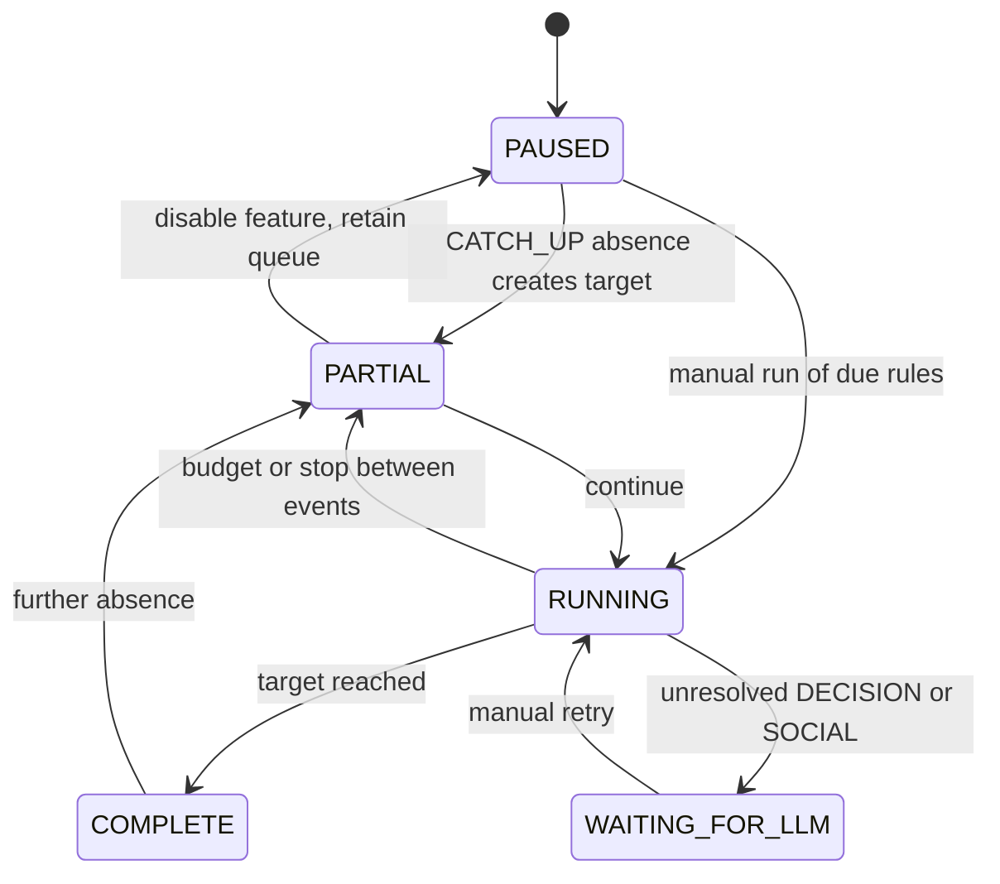

# Living World architecture audit

The persistence/rules foundation from `experiment/living-world-concordia` is in main.
The bounded decisions layer adds optional Concordia without changing existing content
prompt hooks. Living World remains opt-in per session.

## Existing integration points

| Concern | Existing implementation | Integration decision |
| --- | --- | --- |
| Canonical world | `SessionState`, session-owned `WorldEntity`, `WorldScene`, `WorldExit` | Reuse canonical positions and game minutes. |
| Session serialization | `visual_novel/concurrency.py`, `session_mutations.py` | Share the nonblocking session write lease. The supported launcher is single-worker. |
| Foreground priority | `memory_rag/scheduling.py` | Do not introduce another background LLM loop. |
| Regenerate | `turn_replay/snapshot.py` snapshots SQL columns | Store simulation persistence on SessionState so snapshots remain atomic. |
| Chronicles | `session_checkpoint_service.py` explicitly selects fields | Add simulation snapshot and restore hook; fork timeline identity on rewind. |
| Export/import/copy | `session_exporter.py`, `import_restore_session_bundle.py`, `session_copy_state.py` | Export state, validate imports, reset presence and fork timeline on copy/import. |
| RAG | SQL history and summaries with LanceDB derived indexes | No parallel RAG; private simulation plans must not enter recall as facts. |
| NPC relationships | `visual_novel/social.py`, NPC journal | Existing player relationships are not a complete NPC-to-NPC simulation. |
| UI | `SessionSettingsModal.vue`, `useSessionPlaytime.ts`, `GameView.vue` | Add opt-in session controls and independent presence lifecycle. |
| Localization | English UI strings; no vue-i18n dependency/catalog found | Match the existing English UI, keep new strings together. |

## Persistence boundary

Use a nullable JSON column `SessionState.living_world` for the first vertical slice.
This is SQL persistence, not an in-memory queue or a second vector database. It keeps
the timeline, settings, clocks and bounded queue in the same transaction and existing
snapshot as canonical changes. A separate indexed event table is appropriate before
unbounded world histories; do not silently discard committed events to fit a limit.

There are four distinct clocks: server UTC presence, canonical `in_game_time`, the
committed simulation cursor, and the requested catch-up target. Only committed steps
may advance the cursor. PAUSE never converts offline UTC into game minutes. Presence
heartbeats do not execute events or invoke LLMs. CATCH_UP must retain its unprocessed
target, and a waiting decision must stop dependent advancement.

## Work stages and limits

1. Persistence, PAUSE, presence, owner-scoped controls, snapshot lifecycle and tests.
2. Bounded rules-only catch-up, deterministic event execution and recovery tests.
3. Private NPC deliberation after inference serialization and late-response fencing.
4. Optional Concordia adapter, followed by actual adapter compatibility tests.

The existing idle scheduler does not ensure remote generation stops on timeout. A
local cancellation alone must not be treated as proof that the GPU is free. Do not
enable autonomous remote reasoning until its lifecycle is correctly fenced against
foreground generation. Process-local session leases do not support multi-worker
deployment; enabling the experiment does not change that deployment contract.

## Concordia reconnaissance

PyPI `gdm-concordia==2.4.0` declares Python >=3.12 and Apache 2.0. TaleWeaver supports
Python >=3.10,<3.14. Its dependencies include numpy>=1.26, pandas, matplotlib, IPython,
reactivex and tenacity; provider integrations are extras. A required dependency would
break supported Python versions. Use an optional, version-pinned adapter on Python
3.12/3.13, with no automatic package installation on normal game startup.

Sources: https://pypi.org/pypi/gdm-concordia/json and
https://github.com/google-deepmind/concordia . The pinned wheel API was inspected, and the implemented adapter is now tested
against the installed 2.4.0 package with controlled model replies.

The published 2.4.0 wheel was also inspected: the real integration surface is
`concordia.environment.engines.sequential.Sequential.run_loop(game_masters=...,
entities=..., max_steps=...)`, with entity `name`, `observe` and `act(ActionSpec)`
methods. Even this sequential engine prepares observations through Concordia's
concurrency utilities. The adapter bounds those calls through TaleWeaver's inference reservation.
Concordia preparation uses deterministic observations; only the selected actor can
request one model action. No independent NPC thread owns an HTTP client.

## Implemented schema and state machine

Migration `9a0c4e7b1d62` adds two nullable JSON columns, preserving old rows:

| Column | Contents | Snapshot policy |
| --- | --- | --- |
| session_states.living_world | Version, timeline UUID, revision, settings, cursor/target, consumed absence, fractional minutes, bounded event journal | Included in replay/export/Chronicles; fork timeline on restore/copy/import |
| game_sessions.living_world_presence | Browser clients, UTC last-seen values, cumulative absence and accounting watermark | Independent conditional update; not rewound with game state |

Events use unique IDs within a timeline; prerequisites must precede dependents in
the stored list and game time. Each event's canonical changes and committed status
share one SQL transaction. No SQL transaction waits for an LLM in this preview.
Concurrent gameplay/catch-up uses the existing session lease; duplicate commands
also require a matching revision. Presence uses compare-and-swap independently.

Rules-only resume leaves WAITING_FOR_LLM untouched. Opt-in `/deliberate` or `/cycle`
can resolve it within persisted budgets. A crash after a commit can leave RUNNING
persisted; status reports PARTIAL when no rules runner exists. Failed inference
leaves its event waiting, with an attempt consumed and no invented result.

## Completed implementation stages

1. SQL persistence, PAUSE, ownership/revision controls, independent presence, and
   snapshot lifecycle.
2. Bounded deterministic catch-up, causal dependencies, retained backlog and
   recurring slots. Slots are compiled lazily with rotating bounded NPC cohorts.
3. Private NPC goals/beliefs/observations and one typed decision per request.
   Shared inference admission is required. Invalid output has no world effects.
4. Optional pinned Concordia extra and real `Sequential` adapter compatibility.
   The worker thread bridges to the existing async router; it never touches SQL.
   Only one callback is allowed per step, and cancellation closes the bridge.
5. Session controls, administrator private journal, API/lifecycle and two-NPC
   acceptance tests, a Chromium UI smoke test, and installation documentation.

Live-model playtesting remains a separate acceptance activity. Controlled replies
verify mechanics and privacy, not narrative quality or model reasoning accuracy.

## Decision boundary

1. Acquire the existing session lease, authorize ownership and validate revision.
2. Read the NPC's local evidence and permitted choices. Persist the attempt count,
   commit and release both SQL transaction and lease before model work.
3. Wait for the existing idle scheduler and endpoint reservation. Use the Utility
   role's timeout and configured output cap, without thinking or automatic retries.
4. Reacquire the lease and reload canonical state. Compare a fingerprint covering
   all SessionState columns (including timeline/revision), the actor context and
   current permitted choices. A changed/deleted/rewound world discards the reply.
5. Validate typed action, adjacency, locks and co-presence. Commit the concrete
   outcome and private notes in the same transaction. Narration and RAG never
   receive a proposed action as a committed event.

A frozen prepared snapshot contains only bounded plain data. Existing shared
inference fencing remains independent of game snapshots, since rewind cannot stop
remote GPU work. The supported deployment is still a single backend worker.

## Memory and context budgets

No second vector store is introduced. Private state remains inside the existing
snapshot column. Each NPC replaces its short goal and uncertain belief, with up to
eight committed observations. A bounded narrator block includes only motivations
and at most two recent observations for each of up to three present NPCs
(1,800 JSON characters), never the whole private journal.
Recurring scheduling, retry counts, timeline request allowances and the event cap
are explicit and persisted. Reaching a cap reports the limit rather than discarding
canonical history. See [usage](living-world-usage.md) for exact defaults and controls.

Concordia's design is used as an entity/observation/action/resolution interface,
not as a second source of world truth. The native and Concordia engines share the
same schema, provider reservation, validators, snapshots and acceptance scenarios.
Reference implementations and design sources:

- https://github.com/google-deepmind/concordia
- https://pypi.org/project/gdm-concordia/2.4.0/
- https://arxiv.org/abs/2312.03664
- https://arxiv.org/abs/2507.08892
