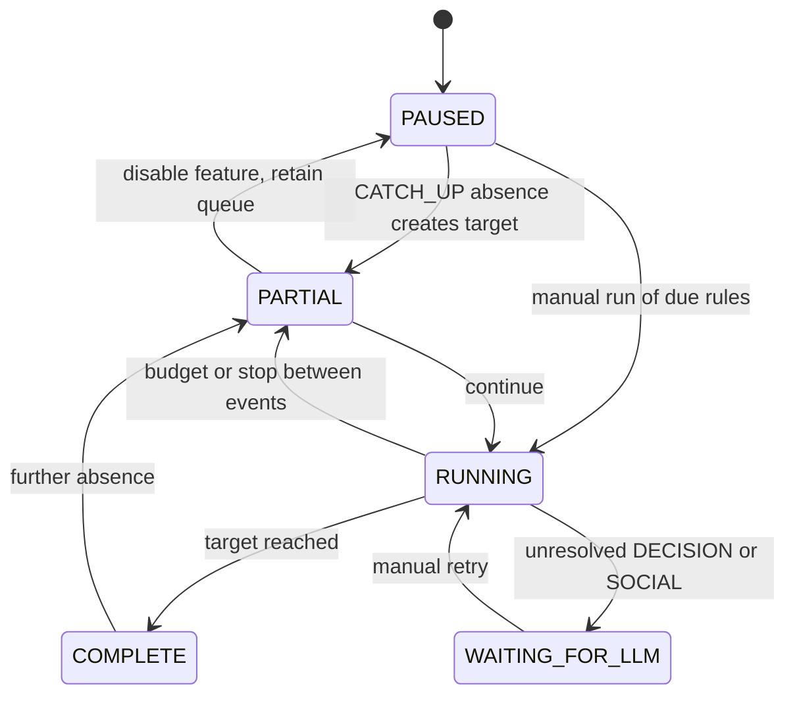

# Living World architecture audit

Experimental branch: `experiment/living-world-concordia`, based on `6ad19d20`.
The feature is opt-in per session. Main and the Mature prompt hooks are unchanged.

## Existing integration points

| Concern | Existing implementation | Integration decision |
| --- | --- | --- |
| Canonical world | `SessionState`, session-owned `WorldEntity`, `WorldScene`, `WorldExit` | Reuse canonical positions and game minutes. |
| Session serialization | `visual_novel/concurrency.py`, `session_mutations.py` | Share the nonblocking session write lease. The supported launcher is single-worker. |
| Foreground priority | `memory_rag/scheduling.py` | Do not introduce another background LLM loop. |
| Regenerate | `turn_replay/snapshot.py` snapshots SQL columns | Store simulation persistence on SessionState so snapshots remain atomic. |
| Chronicles | `session_checkpoint_service.py` explicitly selects fields | Add simulation snapshot and restore hook; fork timeline identity on rewind. |
| Export/import/copy | `session_exporter.py`, `import_restore_session_bundle.py`, `session_copy_state.py` | Export state, validate imports, reset presence and fork timeline on copy/import. |
| RAG | SQL history and summaries with LanceDB derived indexes | No parallel RAG; private simulation plans must not enter recall as facts. |
| NPC relationships | `visual_novel/social.py`, NPC journal | Existing player relationships are not a complete NPC-to-NPC simulation. |
| UI | `SessionSettingsModal.vue`, `useSessionPlaytime.ts`, `GameView.vue` | Add opt-in session controls and independent presence lifecycle. |
| Localization | English UI strings; no vue-i18n dependency/catalog found | Match the existing English UI, keep new strings together. |

## Persistence boundary

Use a nullable JSON column `SessionState.living_world` for the first vertical slice.
This is SQL persistence, not an in-memory queue or a second vector database. It keeps
the timeline, settings, clocks and bounded queue in the same transaction and existing
snapshot as canonical changes. A separate indexed event table is appropriate before
unbounded world histories; do not silently discard committed events to fit a limit.

There are four distinct clocks: server UTC presence, canonical `in_game_time`, the
committed simulation cursor, and the requested catch-up target. Only committed steps
may advance the cursor. PAUSE never converts offline UTC into game minutes. Presence
heartbeats do not execute events or invoke LLMs. CATCH_UP must retain its unprocessed
target, and a waiting decision must stop dependent advancement.

## Work stages and limits

1. Persistence, PAUSE, presence, owner-scoped controls, snapshot lifecycle and tests.
2. Bounded rules-only catch-up, deterministic event execution and recovery tests.
3. Private NPC deliberation after inference serialization and late-response fencing.
4. Optional Concordia adapter, followed by actual adapter compatibility tests.

The existing idle scheduler does not ensure remote generation stops on timeout. A
local cancellation alone must not be treated as proof that the GPU is free. Do not
enable autonomous remote reasoning until its lifecycle is correctly fenced against
foreground generation. Process-local session leases do not support multi-worker
deployment; enabling the experiment does not change that deployment contract.

## Concordia reconnaissance

PyPI `gdm-concordia==2.4.0` declares Python >=3.12 and Apache 2.0. TaleWeaver supports
Python >=3.10,<3.14. Its dependencies include numpy>=1.26, pandas, matplotlib, IPython,
reactivex and tenacity; provider integrations are extras. A required dependency would
break supported Python versions. Use an optional, version-pinned adapter on Python
3.12/3.13, with no automatic package installation on normal game startup.

Sources: https://pypi.org/pypi/gdm-concordia/json and
https://github.com/google-deepmind/concordia . Metadata verification is not an
integration test; no claim of a working Concordia adapter is made at this stage.

The published 2.4.0 wheel was also inspected: the real integration surface is
`concordia.environment.engines.sequential.Sequential.run_loop(game_masters=...,
entities=..., max_steps=...)`, with entity `name`, `observe` and `act(ActionSpec)`
methods. Even this sequential engine prepares observations through Concordia's
concurrency utilities. A future adapter must bound those calls through TaleWeaver's
inference reservation, not let independent NPCs issue competing remote requests.

## Implemented schema and state machine

Migration `9a0c4e7b1d62` adds two nullable JSON columns, preserving old rows:

| Column | Contents | Snapshot policy |
| --- | --- | --- |
| session_states.living_world | Version, timeline UUID, revision, settings, cursor/target, consumed absence, fractional minutes, bounded event journal | Included in replay/export/Chronicles; fork timeline on restore/copy/import |
| game_sessions.living_world_presence | Browser clients, UTC last-seen values, cumulative absence and accounting watermark | Independent conditional update; not rewound with game state |

Events use unique IDs within a timeline; prerequisites must precede dependents in
the stored list and game time. Each event's canonical changes and committed status
share one SQL transaction. No SQL transaction waits for an LLM in this preview.
Concurrent gameplay/catch-up uses the existing session lease; duplicate commands
also require a matching revision. Presence uses compare-and-swap independently.

WAITING_FOR_LLM retries do not contact a provider in this preview. A crash after a
commit can leave RUNNING persisted; the status endpoint reports PARTIAL if no runner
exists. FAILED is reserved for a future persisted job-error lifecycle, not emitted
by the current rules runner.

## Stage ledger and next prerequisite

- Stage 0: architecture/source inspection complete; no changes to main.
- Stage 1: SQL migration, PAUSE, presence, ownership/revision controls, settings UI,
  and snapshot lifecycle implemented and tested.
- Stage 2: explicit event schedules, bounded rules catch-up, retained backlog,
  cancellation and crash recovery implemented. Recurring schedule generation remains
  unimplemented. See usage documentation for the executable mechanical demo.
- Stages 3–4: not implemented; no pretend deliberation or Concordia wrapper.
- Stage 5: preview controls, API/lifecycle tests and documentation implemented.
  Real-browser E2E, private-journal screen and autonomous acceptance demo remain.

The blocker to enabling stage 3 safely is concrete: `memory_rag/scheduling.py` admits
maintenance on idle state, but cannot guarantee that an already-running remote call
has stopped when foreground work starts or a local timeout fires. The current session
write lease serializes one session's mutations, not inference across sessions sharing
the same Ollama/KoboldCpp endpoint. A new simulation loop would amplify that race.

Required next change: an endpoint-scoped shared inference reservation used by both
foreground and background callers; persist or quarantine indeterminate remote work;
then add bounded deliberation with timeline/revision checks before applying a result.
Do not reserve a SQLite write transaction while waiting. Afterward implement private
NPC observations/beliefs and the optional Python >=3.12 Concordia group. These are
cross-cutting scheduler changes, deliberately outside the tested rules-only slice.
