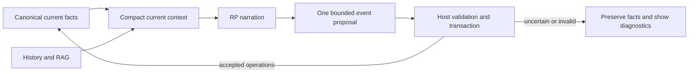

# RP state reconciliation: investigation and free-endpoint pilot

Date: 2026-11-07. Application inspected at `059089cf`. This report proposes future state work; it does not claim a physical-condition ledger has been implemented.

## Finding

Use a small, persistent canonical state and evidence-backed proposed operations. Let the host own IDs, ownership, lifecycle transitions, idempotency and persistence. Let the model interpret the episode. This prevents many structural failures without encoding every possible story in Python. It does **not** prove that the model understood an episode correctly.

A cheap model that silently misses events is unsuitable even when a validator prevents it from corrupting existing records. Measure required-update recall separately from preservation of old facts. A successful no-op is not evidence that treatment, cleaning or movement was understood.

## What TaleWeaver currently does

The [turn manager](https://github.com/Gam1409/taleweaver/blob/059089cf/backend/engine/gameplay/manager.py) first asks a continuity model about the player's attempt, validates/applies permitted world changes, prepares NPC Personality when enabled, and asks the narrator to write. NPC Personality live mode reviews its controlled NPC replies before publication. After narration, [item reconciliation](https://github.com/Gam1409/taleweaver/blob/059089cf/backend/engine/narrated_items/runtime.py) examines the completed reply; optional scene staging has another check. Background journals and memory maintenance are separate.

This is already more than a single model call. A finished-looking reply can precede the turn's final inventory/staging checks. Browsers being unresponsive and a server still finalizing a turn are different problems.

Saved clothing profiles, possessions, item condition notes, NPC observations and causal accounts exist. A general host lifecycle for wounds, skin contamination, fluid traces and explicit physical resolution does **not** exist. Observer memories of a circumstance are not a substitute for authoritative current physical state.

Specific findings:

- Known item identification currently includes full descriptions and has a 64,000-character payload cap. Rich inventories can use the budget on repeated metadata. Prefer compact identification fields; hydrate unchanged canonical definitions on the host.
- Clothing mechanics context currently selects at most 12 actors and 48 garments per actor. A scene with 20 NPCs needs selection that preserves the actual participants and makes any omission explicit.
- Narration intentionally receives visible clothing, not private NPC inventories. The proposed state work must preserve that knowledge boundary.
- [Inference admission](https://github.com/Gam1409/taleweaver/blob/059089cf/backend/core/inference/registry.py) queues calls with foreground priority. Its uncertain-request fence must not be bypassed after a timeout.
- [Session write leases](https://github.com/Gam1409/taleweaver/blob/059089cf/backend/engine/visual_novel/concurrency.py) reject overlapping world turns; they are not a durable player-action queue. The input textarea is currently disabled while it cannot send.

## What the literature supports

LongMemEval explicitly separates extraction, temporal reasoning, knowledge updates and abstention. LoCoMo uses temporal event graphs and human verification, and finds that long context and RAG still leave important temporal/causal errors. Neither establishes clinical or psychological correctness for this game.

Lost in the Middle shows that fitting relevant facts into context does not ensure robust use of them. Keep the current canonical snapshot close to the current episode instead of asking the model to reconstruct current truth from an undifferentiated history.

Generative Agents separates observation, memory, reflection and planning. Its architecture supports treating memories and goals as distinct inputs, not using a remembered description as automatic world truth.

The self-correction paper concerns intrinsic correction without external feedback; it does not prove that all review is useless. A second model pass using the same mistaken interpretation is not independent verification. Structured decoding constrains syntax and allowed values; it does not establish whether “disinfected” means “healed”.

Event sourcing provides useful ideas for audit and replay, but does not require an enterprise event platform here. Session JSON, a small event journal, current snapshots and existing full-turn recovery can support a first version.

## Experiment: scope and method

Only synthetic adult characters and ordinary medical/household events were sent. No real session text, credentials, private adventure or paid Pod was used. The fluid example is saline in a catheter tube; there are no explicit sexual scenes.

AI Horde reported `koboldcpp/Qwen_Qwen3-0.6B-IQ4_XS`. A community worker's model identity is self-reported, not independently attested. The actual batch used Qwen ChatML, `/no_think`, a closed-thinking prefix, temperature 0.1, top_p 0.9, 256 output tokens and a 4096 context limit. A later copy-token/2+2 canary passed. These results describe this endpoint/configuration, not every Qwen deployment. Sampling was not an exhaustive tuning search.

Twelve cases cover unrelated speech, disinfection versus healing, two owners' coats, outside versus inside fluid, partial drainage, an unsuccessful request, NPC-only travel, complete drainage, recalled past events, Russian ownership, quoted instructions as data, and 32 short historical turns. The state contains seven facts. This is an extraction pilot, not a psychology or full RP benchmark.

Three views use two generations per case:

1. Full snapshot: the model returns the complete current state; a naive replacement baseline, **not** TaleWeaver's production storage policy.
2. Verbose delta: the model returns ID, target, previous/new value and exact evidence.
3. Host-checked delta: the **same** delta output is checked for known ID, owner, matching old value, allowed state enum and an exact current-narration quote. No third model call is made.

The prototype validator is not a medical simulator or a complete semantic transition verifier. At most one Horde generation was intentionally outstanding at a time. A warm-up and one interrupted attempt are excluded from scored rows. An initial controller did not stop on HTTP 402; it was corrected. No payment credentials were supplied and no paid access was enabled.

### Results

| Measure | Result |
| --- | --- |
| Horde evaluated attempts | 24: 12 full snapshots + 12 verbose deltas |
| Full snapshots parsing as JSON | 11/12 |
| Full snapshots strictly matching all keys and gold values | 0/12 |
| Full snapshots matching known facts when extra keys are ignored | 4/12 |
| Verbose deltas parsing as JSON | 8/12 |
| Unchecked deltas producing exactly the gold state | 2/12 |
| Checked resulting state matching gold, including unchanged fallback | 5/12 |
| Required individual fact changes applied by checked deltas | 0/8 |
| Median completed full-snapshot latency | 35.47 s |
| Median completed verbose-delta latency | 35.58 s |

The extra `FACT_ID` placeholder copied from the template explains several strict-protocol failures. Ignoring that extra key does not solve missed updates. There are five no-change episodes; preserving the initial state can therefore look superficially successful while missing all eight required updates. This is why preservation and recall are reported separately.

The simpler follow-up removes placeholder IDs and redundant model-supplied owner/old-state fields. It uses a dictionary keyed by actual canonical IDs; the host derives the redundant fields. Four of five task outputs parsed; one of five produced the correct resulting state. It applied **0/5 required fact changes**. The model copied current values with real quotes that did not establish those values. Protocol improved; semantic recall did not. This small follow-up changes multiple prompt/format details and is not a statistically controlled one-variable study.

The initial short contexts used 419–1638 tokens according to the official Qwen tokenizer on the client. A separate 40-turn case with changing circumstances used **3478 tokens**, within the advertised worker limit, and timed out at the 100-second client deadline; cancellation was requested. This is an availability/latency result, not proof that the model forgot the history. A 131k-token session was not tested.

Pollinations advertised an anonymous `openai-fast` endpoint and reported `gpt-oss-20b`. Of 24 batch attempts, two completed correctly and 22 returned HTTP 402. The two completed calls reported 467/108 and 474/97 input/output tokens and took 10.19/9.33 seconds. That is insufficient for a model-quality comparison. Further Pollinations calls were stopped; no account, billing credential or paid fallback was used.

All service timings include network and public queue delay. Horde did not provide reliable per-call generated-token usage. Do not use these times to predict performance on the user's local A100/A40 or to attribute delay solely to model size.

### A semantic counterexample

An offline fault-injection test supplies this proposed update:

```json
{"id":"WOUND","target":"RIN","from":"open","to":"healed","evidence":"Rin disinfects the neck wound."}
```

The prototype's ID/owner/enum/exact-quote checks accept it, although the correct state is `treated`. This counterexample was inserted deliberately; it is **not** claimed to be an observed model answer. Six ordinary protocol checks passed, while this semantic counterexample remained undetected. A quote is provenance, not a proof of meaning.

## Recommended architecture



Use a condition record with a session-scoped target, stable ID, type, body/item part, current status, visibility and source reference. Proposed operations should be create, treat, reduce, clean, transfer where applicable, and explicitly resolve. Do not ask the model to rewrite the whole condition list.

General invariants should cover session ownership, stable IDs, typed operations, exact source/revision, host-side snapshot/CAS, idempotency, no deletion by omission, and transactional replay. Treatment keeps a wound. Partial drainage keeps a residue. Cleaning one garment does not clean a different garment or the body. Healing magic can exist when established world rules permit it; do not hardcode universal medical timing for every genre.

The model still interprets whether treatment, healing, a genuine transfer or merely a claim occurred. A typed operation narrows its choice; it does not make that interpretation infallible. Ambiguous changes need a visible pending/review status. Never disguise a technical failure as an invented in-world obstacle, and never put validator vocabulary into an NPC's dialogue.

Keep physical truth, individual knowledge and appraised emotions separate. Give an NPC their own relevant state and observable facts about others. A hidden condition does not become everyone else's knowledge. Physical aftermath should not rewrite original personality traits automatically.

RAG should retrieve historical causes and reports. Active wounds, ownership and unresolved goals should be loaded by canonical IDs; an older retrieved passage cannot silently restore an obsolete state. Preserve resolved history for explanation without feeding every old condition into every turn.

## Latency and rollout

At a sustained 20 output tokens/s, 100/300/600 output tokens take about 5/15/30 seconds **before** prefill, queue and transport costs. A 3000-token input is not a 3000-token output. A short structured delta can be cheaper than a broad report, but a weak model's 35-second endpoint failure is not a useful saving.

Start by reusing the existing post-narration item check for bounded physical-event proposals rather than adding another serial request. Do not immediately merge personality decisions, all emotions, inventories, scene creation and a whole medical simulation into one giant prompt. Keep static schemas cacheable, known-item identification compact, and current facts separate from historical material. An adequate technical model must pass the positive-update cases as well as no-change cases.

For 5–20 NPCs, retain the whole scene's canonical facts and provide relevant compact projections. Deep psychological processing can remain limited to active interlocutors. Budget by changed facts, not by regenerating every NPC's entire state.

A cheap independent UX improvement is to keep the next draft editable while checks finish. A player-action queue should be explicit, session-scoped and cancellable, execute only after the previous turn commits, and pause on failure or uncertain inference. It must interpret the queued action against the resulting state, rather than applying an old precomputed outcome. Do not parallelize dependent world turns to hide the delay.

Before production state work, use a held-out test matrix with treatment/complete healing, partial/complete removal, two similar owners, clothing layers, older RAG passages, negation, intentions versus completion, cross-location events, privacy, malformed JSON, retries and full-turn regeneration. Record false mutations, missed changes, valid-output rate, end-to-end latency, actual token usage and repair frequency. This tiny-model pilot does not establish psychological realism, NSFW consistency, reliable 20-NPC operation or a production latency target.

## Artifacts and references

[Cases and exact prompts](rp-state-eval-2026-11-07/cases.json), [Horde results](rp-state-eval-2026-11-07/horde-results.jsonl), [Pollinations results](rp-state-eval-2026-11-07/pollinations-results.jsonl), [compact follow-up](rp-state-eval-2026-11-07/compact-results.jsonl), [40-turn case](rp-state-eval-2026-11-07/long-context-case.json), [host counterexample](rp-state-eval-2026-11-07/host-checks.json), and [machine-readable summary](rp-state-eval-2026-11-07/summary.json). Only parsed public JSON, timing and usage metadata are published; provider thinking traces are excluded.

1. [LongMemEval: information extraction, temporal reasoning, knowledge updates and abstention](https://arxiv.org/abs/2410.10813).
2. [LoCoMo: long conversational memory, temporal event graphs and human review](https://arxiv.org/abs/2402.17753).
3. [Generative Agents: observations, memory, reflection and planning](https://arxiv.org/abs/2304.03442).
4. [Lost in the Middle: sensitivity to where relevant information appears](https://arxiv.org/abs/2307.03172).
5. [Large Language Models Cannot Self-Correct Reasoning Yet](https://arxiv.org/abs/2310.01798).
6. [vLLM structured outputs](https://docs.vllm.ai/en/latest/features/structured_outputs.html).
7. [Microsoft Event Sourcing pattern and its complexity tradeoffs](https://learn.microsoft.com/en-us/azure/architecture/patterns/event-sourcing).
8. [Official Qwen3-0.6B model card and chat/non-thinking format](https://huggingface.co/Qwen/Qwen3-0.6B).
9. [AI Horde API documentation](https://aihorde.net/api/) and [OpenAPI schema](https://aihorde.net/api/swagger.json).
10. [Pollinations anonymous model catalog, as observed during this experiment](https://text.pollinations.ai/models).

